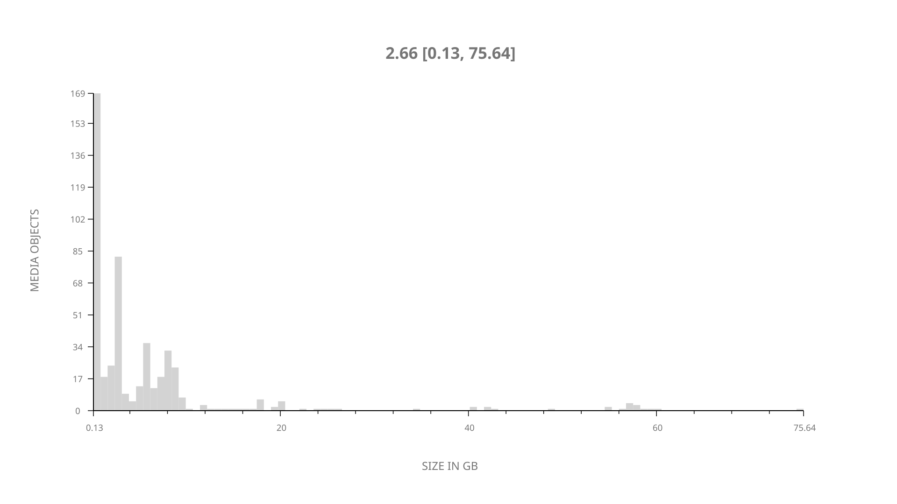
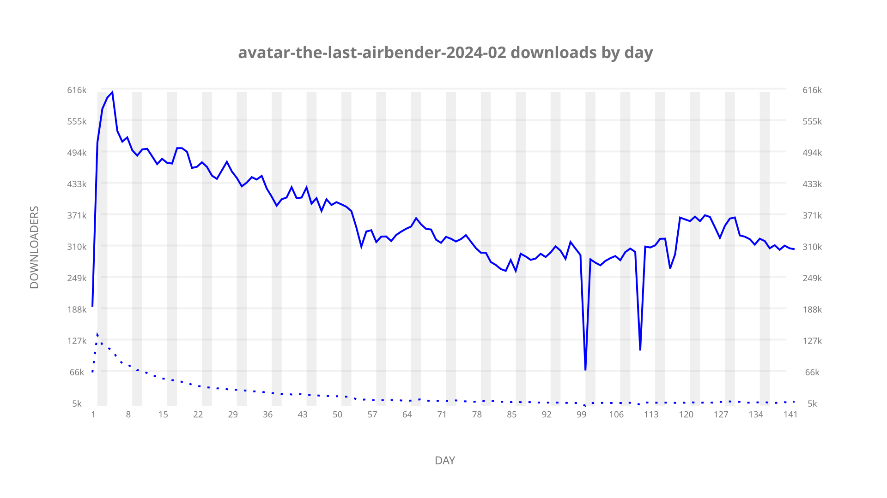
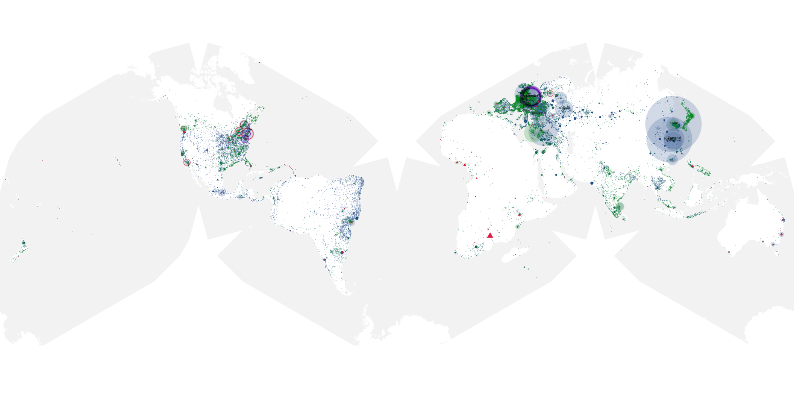
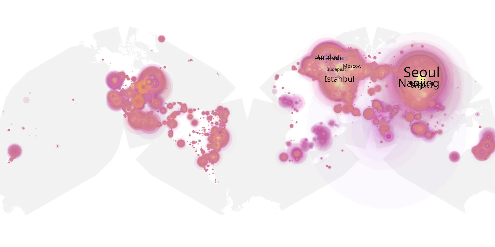
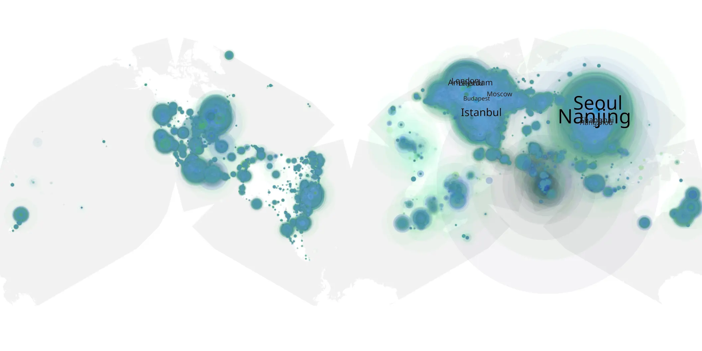

# avatar-the-last-airbender-2024-02 sample cache audit

## 1. Media object

| Field | Value |
| --- | --- |
| Media object | Avatar: The Last Airbender |
| Collection key | `avatar-the-last-airbender-2024-02` |
| imdb_id | [tt9018736](https://www.imdb.com/title/tt9018736/) |
| wikipedia_url | [Avatar: The Last Airbender (2024 TV series)](https://en.wikipedia.org/wiki/Avatar:_The_Last_Airbender_(2024_TV_series)) |
| Sample dates | 2026-06-25-to-2026-11-13 |
| Sample days | 142 |
| BTIH count | 500 |
| Unique BTIH count | 498 |
| Downloaders total | 37,448,255 |
| Uploaders total | 1,612,395 |
| Data version | `2026-08-05` |
| IP geolocation version | `6:1777968300` |

## 2. Coverage report

- Generated: 2026-11-19T21:23:10Z
- Sample archive directory: `/mnt/gold/src/alpha60-samples-raw.gold/avatar-the-last-airbender-2024-02.xz`
- Hour directories: 3353
- Zero-length sample files: 0
- Other unparsable sample files: 0
- Hourly discontinuities: 2 (38 missing hours)
- Missing days: 0

### Sample archive discontinuities

- hourly gap: last `2026-10-01 22:06`, resumed `2026-10-02 19:06` — missing 20 hour(s)
- hourly gap: last `2026-10-12 22:06`, resumed `2026-10-13 17:06` — missing 18 hour(s)

## 3. File sizes histogram *median[lowest, highest]*

## 4. Graphs

### Downloads by week cumulative (normalized start)



### Downloads by day, Saturday and Sunday in gray

## 5. Cumulative Maps

<!-- https://raw.githubusercontent.com/alpha60-devops/alpha60-results-2026/refs/heads/main/data/ -->

### <a href="https://raw.githubusercontent.com/alpha60-devops/alpha60-results-2026/refs/heads/main/data/geojson.cumulative/avatar-the-last-airbender-2024-02-cumulative-aggregate.geojson.gz" data-map-title="Avatar: The Last Airbender — avatar-the-last-airbender-2024-02" onclick="leaflet_map_open_window(this.href, this.dataset.mapTitle); return false;" class="table-link" aria-label="Open Avatar: The Last Airbender (avatar-the-last-airbender-2024-02) cumulative data map in new window" title="Opens interactive map for Avatar: The Last Airbender (avatar-the-last-airbender-2024-02) data">Swarm Detail</a>

### Geographic Regions

| Africa | Americas | Asia | Europe | Oceania | Unknown |
| --- | --- | --- | --- | --- | --- |
| 2.22 | 18.40 | 34.86 | 42.37 | 1.28 | 0.86 |

### Network infrastructure

{:target="_blank" rel="noopener"}

### Resolution >= 1080p

{:target="_blank" rel="noopener"}

### Resolution < 1080p

{:target="_blank" rel="noopener"}
