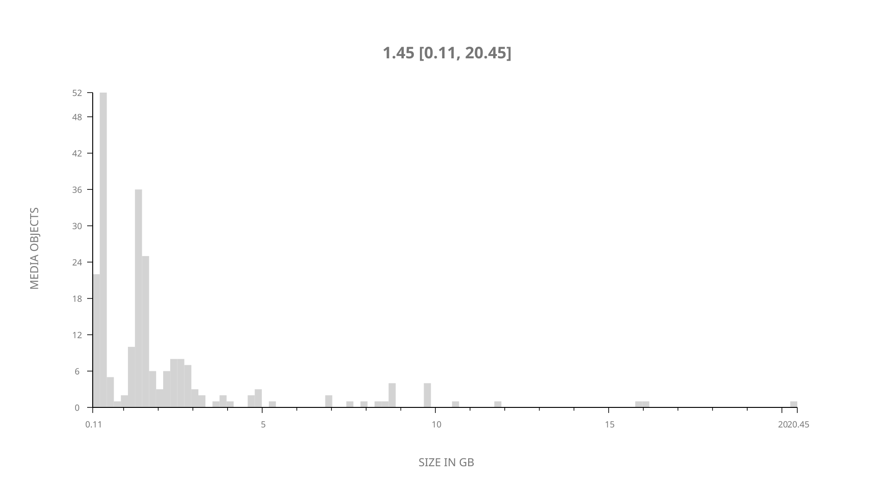
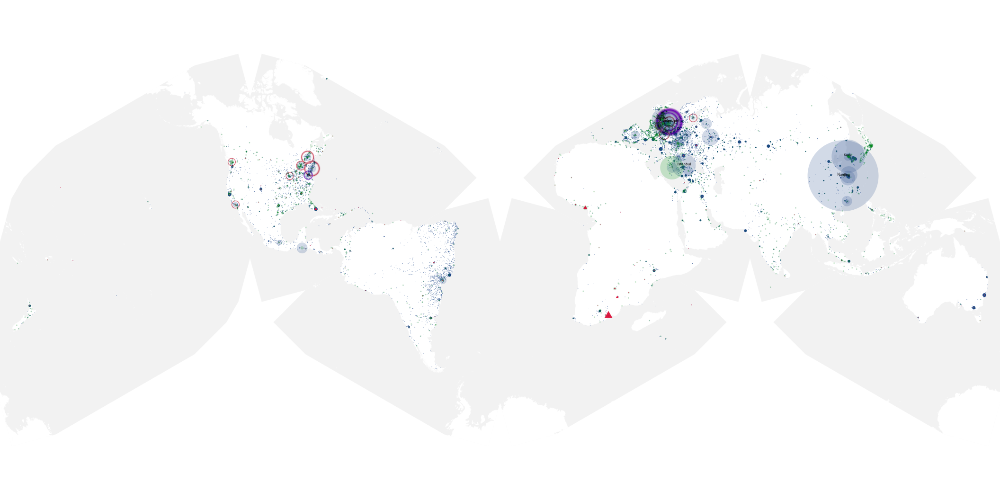
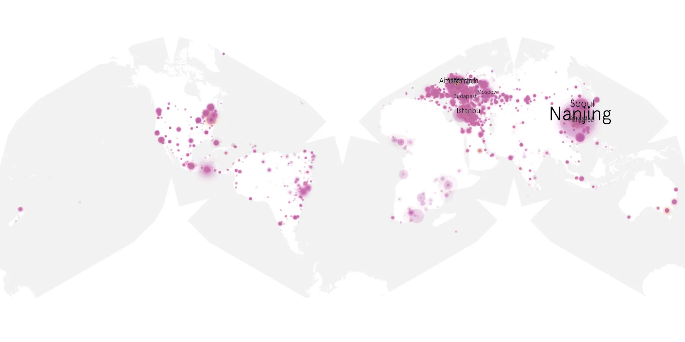
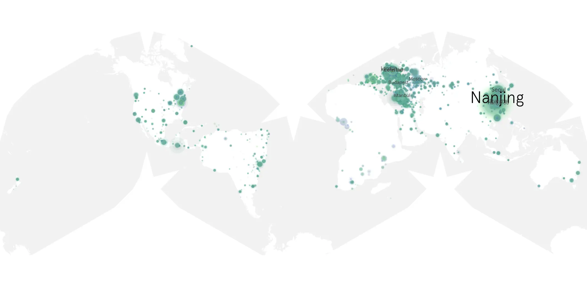

# bass-x-machina-01 sample cache audit

## 1. Media object

| Field | Value |
| --- | --- |
| Media object | Bass X Machina |
| Collection key | `bass-x-machina-01` |
| imdb_id | [tt39957390](https://www.imdb.com/title/tt39957390/) |
| wikipedia_url | [Bass X Machina](https://en.wikipedia.org/wiki/Bass_X_Machina) |
| Sample dates | 2026-11-04-to-2026-11-13 |
| Sample days | 10 |
| BTIH count | 229 |
| Unique BTIH count | 225 |
| Downloaders total | 1,034,650 |
| Uploaders total | 41,995 |
| Data version | `2026-08-05` |
| IP geolocation version | `6:1777968300` |

## 2. Coverage report

- Generated: 2026-11-16T19:36:48Z
- Sample archive directory: `/mnt/gold/src/alpha60-samples-raw.gold/bass-x-machina-01.xz`
- Hour directories: 232
- Zero-length sample files: 0
- Other unparsable sample files: 0
- Hourly discontinuities: 1 (1 missing hours)
- Missing days: 0

### Sample archive discontinuities

- hourly gap: last `2026-11-08 22:02`, resumed `2026-11-09 00:02` — missing 1 hour(s)

## 3. File sizes histogram *median[lowest, highest]*

## 4. Graphs

### Downloads by week cumulative (normalized start)



### Downloads by day, Saturday and Sunday in gray

## 5. Cumulative Maps

<!-- https://raw.githubusercontent.com/alpha60-devops/alpha60-results-2026/refs/heads/main/data/ -->

### <a href="https://raw.githubusercontent.com/alpha60-devops/alpha60-results-2026/refs/heads/main/data/geojson.cumulative/bass-x-machina-01-cumulative-aggregate.geojson.gz" data-map-title="Bass X Machina — bass-x-machina-01" onclick="leaflet_map_open_window(this.href, this.dataset.mapTitle); return false;" class="table-link" aria-label="Open Bass X Machina (bass-x-machina-01) cumulative data map in new window" title="Opens interactive map for Bass X Machina (bass-x-machina-01) data">Swarm Detail</a>

### Geographic Regions

| Africa | Americas | Asia | Europe | Oceania | Unknown |
| --- | --- | --- | --- | --- | --- |
| 2.93 | 19.87 | 31.32 | 43.98 | 1.14 | 0.75 |

### Network infrastructure

{:target="_blank" rel="noopener"}

### Resolution >= 1080p

{:target="_blank" rel="noopener"}

### Resolution < 1080p

{:target="_blank" rel="noopener"}
