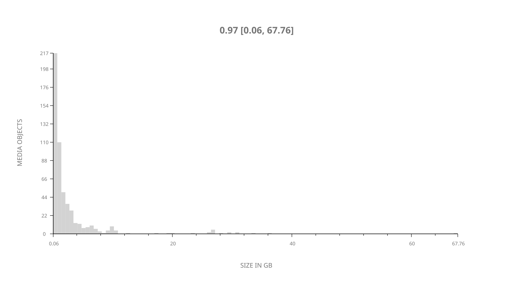
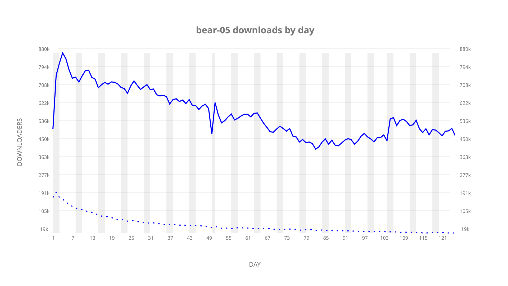
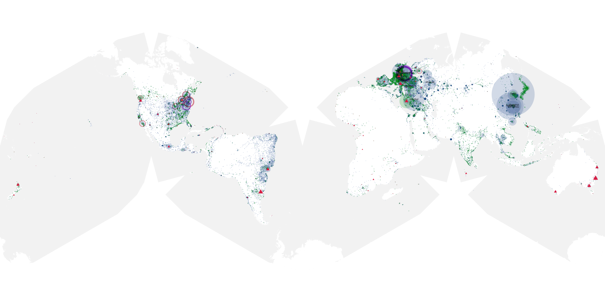
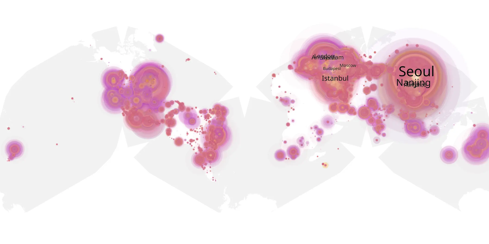
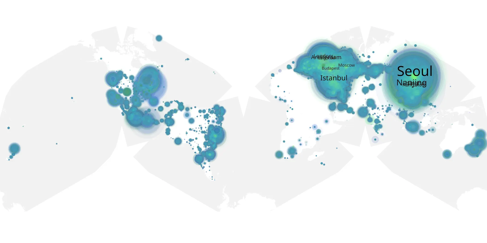

# bear-05 sample cache audit

## 1. Media object

| Field | Value |
| --- | --- |
| Media object | The Bear |
| Collection key | `bear-05` |
| imdb_id | [tt14452776](https://www.imdb.com/title/tt14452776/) |
| wikipedia_url | [The Bear (TV series)](https://en.wikipedia.org/wiki/The_Bear_(TV_series)) |
| Sample dates | 2026-06-26-to-2026-11-13 |
| Sample days | 141 |
| BTIH count | 544 |
| Unique BTIH count | 538 |
| Downloaders total | 51,330,662 |
| Uploaders total | 2,309,262 |
| Data version | `2026-08-05` |
| IP geolocation version | `6:1777968300` |

## 2. Coverage report

- Generated: 2026-11-19T04:21:17Z
- Sample archive directory: `/home/bkoz/src/alpha60-campaigns/year-2026/20261116-v8/objects/bear-05/g1/results/coverage-inputs`
- Hour directories: 2991
- Other unparsable sample files: 0
- Hourly discontinuities: 2 (389 missing hours)
- Missing days: 16

### Sample archive discontinuities

- hourly gap: last `2026-08-14 18:02`, resumed `2026-08-16 00:02` — missing 29 hour(s)
- hourly gap: last `2026-10-08 23:02`, resumed `2026-10-24 00:02` — missing 360 hour(s)
- missing day: `2026-08-15`
- missing day: `2026-10-09`
- missing day: `2026-10-10`
- missing day: `2026-10-11`
- missing day: `2026-10-12`
- missing day: `2026-10-13`
- missing day: `2026-10-14`
- missing day: `2026-10-15`
- missing day: `2026-10-16`
- missing day: `2026-10-17`
- missing day: `2026-10-18`
- missing day: `2026-10-19`
- missing day: `2026-10-20`
- missing day: `2026-10-21`
- missing day: `2026-10-22`
- missing day: `2026-10-23`

## 3. File sizes histogram *median[lowest, highest]*

## 4. Graphs

### Downloads by week cumulative (normalized start)



### Downloads by day, Saturday and Sunday in gray

## 5. Cumulative Maps

<!-- https://raw.githubusercontent.com/alpha60-devops/alpha60-results-2026/refs/heads/main/data/ -->

### <a href="https://raw.githubusercontent.com/alpha60-devops/alpha60-results-2026/refs/heads/main/data/geojson.cumulative/bear-05-cumulative-aggregate.geojson.gz" data-map-title="The Bear — bear-05" onclick="leaflet_map_open_window(this.href, this.dataset.mapTitle); return false;" class="table-link" aria-label="Open The Bear (bear-05) cumulative data map in new window" title="Opens interactive map for The Bear (bear-05) data">Swarm Detail</a>

### Geographic Regions

| Africa | Americas | Asia | Europe | Oceania | Unknown |
| --- | --- | --- | --- | --- | --- |
| 1.44 | 19.55 | 33.39 | 43.35 | 1.40 | 0.87 |

### Network infrastructure

{:target="_blank" rel="noopener"}

### Resolution >= 1080p

{:target="_blank" rel="noopener"}

### Resolution < 1080p

{:target="_blank" rel="noopener"}

<!-- BEGIN alpha60-v8-source-dispositions -->

## Recovered and skipped source samples

360 damaged source archives yielded 0 complete, valid JSON sample files; 360 archives yielded none and were skipped.
Recovered files were retained only after complete JSON validation and archive readback. Damaged original archives remain preserved.
**These source hours are not fully recovered. Lost original membership is unknown.**
The sample-date range does not establish complete observations in the affected hours. No missing observations were fabricated.

| Source archive | Disposition | Valid JSON files recovered |
| --- | --- | ---: |
| `2026-10-09-at-00-02.tar.xz` | skip-no-valid-json | 0 |
| `2026-10-09-at-01-02.tar.xz` | skip-no-valid-json | 0 |
| `2026-10-09-at-02-02.tar.xz` | skip-no-valid-json | 0 |
| `2026-10-09-at-03-02.tar.xz` | skip-no-valid-json | 0 |
| `2026-10-09-at-04-02.tar.xz` | skip-no-valid-json | 0 |
| `2026-10-09-at-05-02.tar.xz` | skip-no-valid-json | 0 |
| `2026-10-09-at-06-02.tar.xz` | skip-no-valid-json | 0 |
| `2026-10-09-at-07-02.tar.xz` | skip-no-valid-json | 0 |
| `2026-10-09-at-08-02.tar.xz` | skip-no-valid-json | 0 |
| `2026-10-09-at-09-02.tar.xz` | skip-no-valid-json | 0 |
| `2026-10-09-at-10-02.tar.xz` | skip-no-valid-json | 0 |
| `2026-10-09-at-11-02.tar.xz` | skip-no-valid-json | 0 |
| `2026-10-09-at-12-02.tar.xz` | skip-no-valid-json | 0 |
| `2026-10-09-at-13-02.tar.xz` | skip-no-valid-json | 0 |
| `2026-10-09-at-14-02.tar.xz` | skip-no-valid-json | 0 |
| `2026-10-09-at-15-02.tar.xz` | skip-no-valid-json | 0 |
| `2026-10-09-at-16-02.tar.xz` | skip-no-valid-json | 0 |
| `2026-10-09-at-17-02.tar.xz` | skip-no-valid-json | 0 |
| `2026-10-09-at-18-02.tar.xz` | skip-no-valid-json | 0 |
| `2026-10-09-at-19-02.tar.xz` | skip-no-valid-json | 0 |
| `2026-10-09-at-20-02.tar.xz` | skip-no-valid-json | 0 |
| `2026-10-09-at-21-02.tar.xz` | skip-no-valid-json | 0 |
| `2026-10-09-at-22-02.tar.xz` | skip-no-valid-json | 0 |
| `2026-10-09-at-23-02.tar.xz` | skip-no-valid-json | 0 |
| `2026-10-10-at-00-02.tar.xz` | skip-no-valid-json | 0 |
| `2026-10-10-at-01-02.tar.xz` | skip-no-valid-json | 0 |
| `2026-10-10-at-02-02.tar.xz` | skip-no-valid-json | 0 |
| `2026-10-10-at-03-02.tar.xz` | skip-no-valid-json | 0 |
| `2026-10-10-at-04-02.tar.xz` | skip-no-valid-json | 0 |
| `2026-10-10-at-05-02.tar.xz` | skip-no-valid-json | 0 |
| `2026-10-10-at-06-02.tar.xz` | skip-no-valid-json | 0 |
| `2026-10-10-at-07-02.tar.xz` | skip-no-valid-json | 0 |
| `2026-10-10-at-08-02.tar.xz` | skip-no-valid-json | 0 |
| `2026-10-10-at-09-02.tar.xz` | skip-no-valid-json | 0 |
| `2026-10-10-at-10-02.tar.xz` | skip-no-valid-json | 0 |
| `2026-10-10-at-11-02.tar.xz` | skip-no-valid-json | 0 |
| `2026-10-10-at-12-02.tar.xz` | skip-no-valid-json | 0 |
| `2026-10-10-at-13-02.tar.xz` | skip-no-valid-json | 0 |
| `2026-10-10-at-14-02.tar.xz` | skip-no-valid-json | 0 |
| `2026-10-10-at-15-02.tar.xz` | skip-no-valid-json | 0 |
| `2026-10-10-at-16-02.tar.xz` | skip-no-valid-json | 0 |
| `2026-10-10-at-17-02.tar.xz` | skip-no-valid-json | 0 |
| `2026-10-10-at-18-02.tar.xz` | skip-no-valid-json | 0 |
| `2026-10-10-at-19-02.tar.xz` | skip-no-valid-json | 0 |
| `2026-10-10-at-20-02.tar.xz` | skip-no-valid-json | 0 |
| `2026-10-10-at-21-02.tar.xz` | skip-no-valid-json | 0 |
| `2026-10-10-at-22-02.tar.xz` | skip-no-valid-json | 0 |
| `2026-10-10-at-23-02.tar.xz` | skip-no-valid-json | 0 |
| `2026-10-11-at-00-02.tar.xz` | skip-no-valid-json | 0 |
| `2026-10-11-at-01-02.tar.xz` | skip-no-valid-json | 0 |
| `2026-10-11-at-02-02.tar.xz` | skip-no-valid-json | 0 |
| `2026-10-11-at-03-02.tar.xz` | skip-no-valid-json | 0 |
| `2026-10-11-at-04-02.tar.xz` | skip-no-valid-json | 0 |
| `2026-10-11-at-05-02.tar.xz` | skip-no-valid-json | 0 |
| `2026-10-11-at-06-02.tar.xz` | skip-no-valid-json | 0 |
| `2026-10-11-at-07-02.tar.xz` | skip-no-valid-json | 0 |
| `2026-10-11-at-08-02.tar.xz` | skip-no-valid-json | 0 |
| `2026-10-11-at-09-02.tar.xz` | skip-no-valid-json | 0 |
| `2026-10-11-at-10-02.tar.xz` | skip-no-valid-json | 0 |
| `2026-10-11-at-11-02.tar.xz` | skip-no-valid-json | 0 |
| `2026-10-11-at-12-02.tar.xz` | skip-no-valid-json | 0 |
| `2026-10-11-at-13-02.tar.xz` | skip-no-valid-json | 0 |
| `2026-10-11-at-14-02.tar.xz` | skip-no-valid-json | 0 |
| `2026-10-11-at-15-02.tar.xz` | skip-no-valid-json | 0 |
| `2026-10-11-at-16-02.tar.xz` | skip-no-valid-json | 0 |
| `2026-10-11-at-17-02.tar.xz` | skip-no-valid-json | 0 |
| `2026-10-11-at-18-02.tar.xz` | skip-no-valid-json | 0 |
| `2026-10-11-at-19-02.tar.xz` | skip-no-valid-json | 0 |
| `2026-10-11-at-20-02.tar.xz` | skip-no-valid-json | 0 |
| `2026-10-11-at-21-02.tar.xz` | skip-no-valid-json | 0 |
| `2026-10-11-at-22-02.tar.xz` | skip-no-valid-json | 0 |
| `2026-10-11-at-23-02.tar.xz` | skip-no-valid-json | 0 |
| `2026-10-12-at-00-02.tar.xz` | skip-no-valid-json | 0 |
| `2026-10-12-at-01-02.tar.xz` | skip-no-valid-json | 0 |
| `2026-10-12-at-02-02.tar.xz` | skip-no-valid-json | 0 |
| `2026-10-12-at-03-02.tar.xz` | skip-no-valid-json | 0 |
| `2026-10-12-at-04-02.tar.xz` | skip-no-valid-json | 0 |
| `2026-10-12-at-05-02.tar.xz` | skip-no-valid-json | 0 |
| `2026-10-12-at-06-02.tar.xz` | skip-no-valid-json | 0 |
| `2026-10-12-at-07-02.tar.xz` | skip-no-valid-json | 0 |
| `2026-10-12-at-08-02.tar.xz` | skip-no-valid-json | 0 |
| `2026-10-12-at-09-02.tar.xz` | skip-no-valid-json | 0 |
| `2026-10-12-at-10-02.tar.xz` | skip-no-valid-json | 0 |
| `2026-10-12-at-11-02.tar.xz` | skip-no-valid-json | 0 |
| `2026-10-12-at-12-02.tar.xz` | skip-no-valid-json | 0 |
| `2026-10-12-at-13-02.tar.xz` | skip-no-valid-json | 0 |
| `2026-10-12-at-14-02.tar.xz` | skip-no-valid-json | 0 |
| `2026-10-12-at-15-02.tar.xz` | skip-no-valid-json | 0 |
| `2026-10-12-at-16-02.tar.xz` | skip-no-valid-json | 0 |
| `2026-10-12-at-17-02.tar.xz` | skip-no-valid-json | 0 |
| `2026-10-12-at-18-02.tar.xz` | skip-no-valid-json | 0 |
| `2026-10-12-at-19-02.tar.xz` | skip-no-valid-json | 0 |
| `2026-10-12-at-20-02.tar.xz` | skip-no-valid-json | 0 |
| `2026-10-12-at-21-02.tar.xz` | skip-no-valid-json | 0 |
| `2026-10-12-at-22-02.tar.xz` | skip-no-valid-json | 0 |
| `2026-10-12-at-23-02.tar.xz` | skip-no-valid-json | 0 |
| `2026-10-13-at-00-02.tar.xz` | skip-no-valid-json | 0 |
| `2026-10-13-at-01-02.tar.xz` | skip-no-valid-json | 0 |
| `2026-10-13-at-02-02.tar.xz` | skip-no-valid-json | 0 |
| `2026-10-13-at-03-02.tar.xz` | skip-no-valid-json | 0 |
| `2026-10-13-at-04-02.tar.xz` | skip-no-valid-json | 0 |
| `2026-10-13-at-05-02.tar.xz` | skip-no-valid-json | 0 |
| `2026-10-13-at-06-02.tar.xz` | skip-no-valid-json | 0 |
| `2026-10-13-at-07-02.tar.xz` | skip-no-valid-json | 0 |
| `2026-10-13-at-08-02.tar.xz` | skip-no-valid-json | 0 |
| `2026-10-13-at-09-02.tar.xz` | skip-no-valid-json | 0 |
| `2026-10-13-at-10-02.tar.xz` | skip-no-valid-json | 0 |
| `2026-10-13-at-11-02.tar.xz` | skip-no-valid-json | 0 |
| `2026-10-13-at-12-02.tar.xz` | skip-no-valid-json | 0 |
| `2026-10-13-at-13-02.tar.xz` | skip-no-valid-json | 0 |
| `2026-10-13-at-14-02.tar.xz` | skip-no-valid-json | 0 |
| `2026-10-13-at-15-02.tar.xz` | skip-no-valid-json | 0 |
| `2026-10-13-at-16-02.tar.xz` | skip-no-valid-json | 0 |
| `2026-10-13-at-17-02.tar.xz` | skip-no-valid-json | 0 |
| `2026-10-13-at-18-02.tar.xz` | skip-no-valid-json | 0 |
| `2026-10-13-at-19-02.tar.xz` | skip-no-valid-json | 0 |
| `2026-10-13-at-20-02.tar.xz` | skip-no-valid-json | 0 |
| `2026-10-13-at-21-02.tar.xz` | skip-no-valid-json | 0 |
| `2026-10-13-at-22-02.tar.xz` | skip-no-valid-json | 0 |
| `2026-10-13-at-23-02.tar.xz` | skip-no-valid-json | 0 |
| `2026-10-14-at-00-02.tar.xz` | skip-no-valid-json | 0 |
| `2026-10-14-at-01-02.tar.xz` | skip-no-valid-json | 0 |
| `2026-10-14-at-02-02.tar.xz` | skip-no-valid-json | 0 |
| `2026-10-14-at-03-02.tar.xz` | skip-no-valid-json | 0 |
| `2026-10-14-at-04-02.tar.xz` | skip-no-valid-json | 0 |
| `2026-10-14-at-05-02.tar.xz` | skip-no-valid-json | 0 |
| `2026-10-14-at-06-02.tar.xz` | skip-no-valid-json | 0 |
| `2026-10-14-at-07-02.tar.xz` | skip-no-valid-json | 0 |
| `2026-10-14-at-08-02.tar.xz` | skip-no-valid-json | 0 |
| `2026-10-14-at-09-02.tar.xz` | skip-no-valid-json | 0 |
| `2026-10-14-at-10-02.tar.xz` | skip-no-valid-json | 0 |
| `2026-10-14-at-11-02.tar.xz` | skip-no-valid-json | 0 |
| `2026-10-14-at-12-02.tar.xz` | skip-no-valid-json | 0 |
| `2026-10-14-at-13-02.tar.xz` | skip-no-valid-json | 0 |
| `2026-10-14-at-14-02.tar.xz` | skip-no-valid-json | 0 |
| `2026-10-14-at-15-02.tar.xz` | skip-no-valid-json | 0 |
| `2026-10-14-at-16-02.tar.xz` | skip-no-valid-json | 0 |
| `2026-10-14-at-17-02.tar.xz` | skip-no-valid-json | 0 |
| `2026-10-14-at-18-02.tar.xz` | skip-no-valid-json | 0 |
| `2026-10-14-at-19-02.tar.xz` | skip-no-valid-json | 0 |
| `2026-10-14-at-20-02.tar.xz` | skip-no-valid-json | 0 |
| `2026-10-14-at-21-02.tar.xz` | skip-no-valid-json | 0 |
| `2026-10-14-at-22-02.tar.xz` | skip-no-valid-json | 0 |
| `2026-10-14-at-23-02.tar.xz` | skip-no-valid-json | 0 |
| `2026-10-15-at-00-02.tar.xz` | skip-no-valid-json | 0 |
| `2026-10-15-at-01-02.tar.xz` | skip-no-valid-json | 0 |
| `2026-10-15-at-02-02.tar.xz` | skip-no-valid-json | 0 |
| `2026-10-15-at-03-02.tar.xz` | skip-no-valid-json | 0 |
| `2026-10-15-at-04-02.tar.xz` | skip-no-valid-json | 0 |
| `2026-10-15-at-05-02.tar.xz` | skip-no-valid-json | 0 |
| `2026-10-15-at-06-02.tar.xz` | skip-no-valid-json | 0 |
| `2026-10-15-at-07-02.tar.xz` | skip-no-valid-json | 0 |
| `2026-10-15-at-08-02.tar.xz` | skip-no-valid-json | 0 |
| `2026-10-15-at-09-02.tar.xz` | skip-no-valid-json | 0 |
| `2026-10-15-at-10-02.tar.xz` | skip-no-valid-json | 0 |
| `2026-10-15-at-11-02.tar.xz` | skip-no-valid-json | 0 |
| `2026-10-15-at-12-02.tar.xz` | skip-no-valid-json | 0 |
| `2026-10-15-at-13-02.tar.xz` | skip-no-valid-json | 0 |
| `2026-10-15-at-14-02.tar.xz` | skip-no-valid-json | 0 |
| `2026-10-15-at-15-02.tar.xz` | skip-no-valid-json | 0 |
| `2026-10-15-at-16-02.tar.xz` | skip-no-valid-json | 0 |
| `2026-10-15-at-17-02.tar.xz` | skip-no-valid-json | 0 |
| `2026-10-15-at-18-02.tar.xz` | skip-no-valid-json | 0 |
| `2026-10-15-at-19-02.tar.xz` | skip-no-valid-json | 0 |
| `2026-10-15-at-20-02.tar.xz` | skip-no-valid-json | 0 |
| `2026-10-15-at-21-02.tar.xz` | skip-no-valid-json | 0 |
| `2026-10-15-at-22-02.tar.xz` | skip-no-valid-json | 0 |
| `2026-10-15-at-23-02.tar.xz` | skip-no-valid-json | 0 |
| `2026-10-16-at-00-02.tar.xz` | skip-no-valid-json | 0 |
| `2026-10-16-at-01-02.tar.xz` | skip-no-valid-json | 0 |
| `2026-10-16-at-02-02.tar.xz` | skip-no-valid-json | 0 |
| `2026-10-16-at-03-02.tar.xz` | skip-no-valid-json | 0 |
| `2026-10-16-at-04-02.tar.xz` | skip-no-valid-json | 0 |
| `2026-10-16-at-05-02.tar.xz` | skip-no-valid-json | 0 |
| `2026-10-16-at-06-02.tar.xz` | skip-no-valid-json | 0 |
| `2026-10-16-at-07-02.tar.xz` | skip-no-valid-json | 0 |
| `2026-10-16-at-08-02.tar.xz` | skip-no-valid-json | 0 |
| `2026-10-16-at-09-02.tar.xz` | skip-no-valid-json | 0 |
| `2026-10-16-at-10-02.tar.xz` | skip-no-valid-json | 0 |
| `2026-10-16-at-11-02.tar.xz` | skip-no-valid-json | 0 |
| `2026-10-16-at-12-02.tar.xz` | skip-no-valid-json | 0 |
| `2026-10-16-at-13-02.tar.xz` | skip-no-valid-json | 0 |
| `2026-10-16-at-14-02.tar.xz` | skip-no-valid-json | 0 |
| `2026-10-16-at-15-02.tar.xz` | skip-no-valid-json | 0 |
| `2026-10-16-at-16-02.tar.xz` | skip-no-valid-json | 0 |
| `2026-10-16-at-17-02.tar.xz` | skip-no-valid-json | 0 |
| `2026-10-16-at-18-02.tar.xz` | skip-no-valid-json | 0 |
| `2026-10-16-at-19-02.tar.xz` | skip-no-valid-json | 0 |
| `2026-10-16-at-20-02.tar.xz` | skip-no-valid-json | 0 |
| `2026-10-16-at-21-02.tar.xz` | skip-no-valid-json | 0 |
| `2026-10-16-at-22-02.tar.xz` | skip-no-valid-json | 0 |
| `2026-10-16-at-23-02.tar.xz` | skip-no-valid-json | 0 |
| `2026-10-17-at-00-02.tar.xz` | skip-no-valid-json | 0 |
| `2026-10-17-at-01-02.tar.xz` | skip-no-valid-json | 0 |
| `2026-10-17-at-02-02.tar.xz` | skip-no-valid-json | 0 |
| `2026-10-17-at-03-02.tar.xz` | skip-no-valid-json | 0 |
| `2026-10-17-at-04-02.tar.xz` | skip-no-valid-json | 0 |
| `2026-10-17-at-05-02.tar.xz` | skip-no-valid-json | 0 |
| `2026-10-17-at-06-02.tar.xz` | skip-no-valid-json | 0 |
| `2026-10-17-at-07-02.tar.xz` | skip-no-valid-json | 0 |
| `2026-10-17-at-08-02.tar.xz` | skip-no-valid-json | 0 |
| `2026-10-17-at-09-02.tar.xz` | skip-no-valid-json | 0 |
| `2026-10-17-at-10-02.tar.xz` | skip-no-valid-json | 0 |
| `2026-10-17-at-11-02.tar.xz` | skip-no-valid-json | 0 |
| `2026-10-17-at-12-02.tar.xz` | skip-no-valid-json | 0 |
| `2026-10-17-at-13-02.tar.xz` | skip-no-valid-json | 0 |
| `2026-10-17-at-14-02.tar.xz` | skip-no-valid-json | 0 |
| `2026-10-17-at-15-02.tar.xz` | skip-no-valid-json | 0 |
| `2026-10-17-at-16-02.tar.xz` | skip-no-valid-json | 0 |
| `2026-10-17-at-17-02.tar.xz` | skip-no-valid-json | 0 |
| `2026-10-17-at-18-02.tar.xz` | skip-no-valid-json | 0 |
| `2026-10-17-at-19-02.tar.xz` | skip-no-valid-json | 0 |
| `2026-10-17-at-20-02.tar.xz` | skip-no-valid-json | 0 |
| `2026-10-17-at-21-02.tar.xz` | skip-no-valid-json | 0 |
| `2026-10-17-at-22-02.tar.xz` | skip-no-valid-json | 0 |
| `2026-10-17-at-23-02.tar.xz` | skip-no-valid-json | 0 |
| `2026-10-18-at-00-02.tar.xz` | skip-no-valid-json | 0 |
| `2026-10-18-at-01-02.tar.xz` | skip-no-valid-json | 0 |
| `2026-10-18-at-02-02.tar.xz` | skip-no-valid-json | 0 |
| `2026-10-18-at-03-02.tar.xz` | skip-no-valid-json | 0 |
| `2026-10-18-at-04-02.tar.xz` | skip-no-valid-json | 0 |
| `2026-10-18-at-05-02.tar.xz` | skip-no-valid-json | 0 |
| `2026-10-18-at-06-02.tar.xz` | skip-no-valid-json | 0 |
| `2026-10-18-at-07-02.tar.xz` | skip-no-valid-json | 0 |
| `2026-10-18-at-08-02.tar.xz` | skip-no-valid-json | 0 |
| `2026-10-18-at-09-02.tar.xz` | skip-no-valid-json | 0 |
| `2026-10-18-at-10-02.tar.xz` | skip-no-valid-json | 0 |
| `2026-10-18-at-11-02.tar.xz` | skip-no-valid-json | 0 |
| `2026-10-18-at-12-02.tar.xz` | skip-no-valid-json | 0 |
| `2026-10-18-at-13-02.tar.xz` | skip-no-valid-json | 0 |
| `2026-10-18-at-14-02.tar.xz` | skip-no-valid-json | 0 |
| `2026-10-18-at-15-02.tar.xz` | skip-no-valid-json | 0 |
| `2026-10-18-at-16-02.tar.xz` | skip-no-valid-json | 0 |
| `2026-10-18-at-17-02.tar.xz` | skip-no-valid-json | 0 |
| `2026-10-18-at-18-02.tar.xz` | skip-no-valid-json | 0 |
| `2026-10-18-at-19-02.tar.xz` | skip-no-valid-json | 0 |
| `2026-10-18-at-20-02.tar.xz` | skip-no-valid-json | 0 |
| `2026-10-18-at-21-02.tar.xz` | skip-no-valid-json | 0 |
| `2026-10-18-at-22-02.tar.xz` | skip-no-valid-json | 0 |
| `2026-10-18-at-23-02.tar.xz` | skip-no-valid-json | 0 |
| `2026-10-19-at-00-02.tar.xz` | skip-no-valid-json | 0 |
| `2026-10-19-at-01-02.tar.xz` | skip-no-valid-json | 0 |
| `2026-10-19-at-02-02.tar.xz` | skip-no-valid-json | 0 |
| `2026-10-19-at-03-02.tar.xz` | skip-no-valid-json | 0 |
| `2026-10-19-at-04-02.tar.xz` | skip-no-valid-json | 0 |
| `2026-10-19-at-05-02.tar.xz` | skip-no-valid-json | 0 |
| `2026-10-19-at-06-02.tar.xz` | skip-no-valid-json | 0 |
| `2026-10-19-at-07-02.tar.xz` | skip-no-valid-json | 0 |
| `2026-10-19-at-08-02.tar.xz` | skip-no-valid-json | 0 |
| `2026-10-19-at-09-02.tar.xz` | skip-no-valid-json | 0 |
| `2026-10-19-at-10-02.tar.xz` | skip-no-valid-json | 0 |
| `2026-10-19-at-11-02.tar.xz` | skip-no-valid-json | 0 |
| `2026-10-19-at-12-02.tar.xz` | skip-no-valid-json | 0 |
| `2026-10-19-at-13-02.tar.xz` | skip-no-valid-json | 0 |
| `2026-10-19-at-14-02.tar.xz` | skip-no-valid-json | 0 |
| `2026-10-19-at-15-02.tar.xz` | skip-no-valid-json | 0 |
| `2026-10-19-at-16-02.tar.xz` | skip-no-valid-json | 0 |
| `2026-10-19-at-17-02.tar.xz` | skip-no-valid-json | 0 |
| `2026-10-19-at-18-02.tar.xz` | skip-no-valid-json | 0 |
| `2026-10-19-at-19-02.tar.xz` | skip-no-valid-json | 0 |
| `2026-10-19-at-20-02.tar.xz` | skip-no-valid-json | 0 |
| `2026-10-19-at-21-02.tar.xz` | skip-no-valid-json | 0 |
| `2026-10-19-at-22-02.tar.xz` | skip-no-valid-json | 0 |
| `2026-10-19-at-23-02.tar.xz` | skip-no-valid-json | 0 |
| `2026-10-20-at-00-02.tar.xz` | skip-no-valid-json | 0 |
| `2026-10-20-at-01-02.tar.xz` | skip-no-valid-json | 0 |
| `2026-10-20-at-02-02.tar.xz` | skip-no-valid-json | 0 |
| `2026-10-20-at-03-02.tar.xz` | skip-no-valid-json | 0 |
| `2026-10-20-at-04-02.tar.xz` | skip-no-valid-json | 0 |
| `2026-10-20-at-05-02.tar.xz` | skip-no-valid-json | 0 |
| `2026-10-20-at-06-02.tar.xz` | skip-no-valid-json | 0 |
| `2026-10-20-at-07-02.tar.xz` | skip-no-valid-json | 0 |
| `2026-10-20-at-08-02.tar.xz` | skip-no-valid-json | 0 |
| `2026-10-20-at-09-02.tar.xz` | skip-no-valid-json | 0 |
| `2026-10-20-at-10-02.tar.xz` | skip-no-valid-json | 0 |
| `2026-10-20-at-11-02.tar.xz` | skip-no-valid-json | 0 |
| `2026-10-20-at-12-02.tar.xz` | skip-no-valid-json | 0 |
| `2026-10-20-at-13-02.tar.xz` | skip-no-valid-json | 0 |
| `2026-10-20-at-14-02.tar.xz` | skip-no-valid-json | 0 |
| `2026-10-20-at-15-02.tar.xz` | skip-no-valid-json | 0 |
| `2026-10-20-at-16-02.tar.xz` | skip-no-valid-json | 0 |
| `2026-10-20-at-17-02.tar.xz` | skip-no-valid-json | 0 |
| `2026-10-20-at-18-02.tar.xz` | skip-no-valid-json | 0 |
| `2026-10-20-at-19-02.tar.xz` | skip-no-valid-json | 0 |
| `2026-10-20-at-20-02.tar.xz` | skip-no-valid-json | 0 |
| `2026-10-20-at-21-02.tar.xz` | skip-no-valid-json | 0 |
| `2026-10-20-at-22-02.tar.xz` | skip-no-valid-json | 0 |
| `2026-10-20-at-23-02.tar.xz` | skip-no-valid-json | 0 |
| `2026-10-21-at-00-02.tar.xz` | skip-no-valid-json | 0 |
| `2026-10-21-at-01-02.tar.xz` | skip-no-valid-json | 0 |
| `2026-10-21-at-02-02.tar.xz` | skip-no-valid-json | 0 |
| `2026-10-21-at-03-02.tar.xz` | skip-no-valid-json | 0 |
| `2026-10-21-at-04-02.tar.xz` | skip-no-valid-json | 0 |
| `2026-10-21-at-05-02.tar.xz` | skip-no-valid-json | 0 |
| `2026-10-21-at-06-02.tar.xz` | skip-no-valid-json | 0 |
| `2026-10-21-at-07-02.tar.xz` | skip-no-valid-json | 0 |
| `2026-10-21-at-08-02.tar.xz` | skip-no-valid-json | 0 |
| `2026-10-21-at-09-02.tar.xz` | skip-no-valid-json | 0 |
| `2026-10-21-at-10-02.tar.xz` | skip-no-valid-json | 0 |
| `2026-10-21-at-11-02.tar.xz` | skip-no-valid-json | 0 |
| `2026-10-21-at-12-02.tar.xz` | skip-no-valid-json | 0 |
| `2026-10-21-at-13-02.tar.xz` | skip-no-valid-json | 0 |
| `2026-10-21-at-14-02.tar.xz` | skip-no-valid-json | 0 |
| `2026-10-21-at-15-02.tar.xz` | skip-no-valid-json | 0 |
| `2026-10-21-at-16-02.tar.xz` | skip-no-valid-json | 0 |
| `2026-10-21-at-17-02.tar.xz` | skip-no-valid-json | 0 |
| `2026-10-21-at-18-02.tar.xz` | skip-no-valid-json | 0 |
| `2026-10-21-at-19-02.tar.xz` | skip-no-valid-json | 0 |
| `2026-10-21-at-20-02.tar.xz` | skip-no-valid-json | 0 |
| `2026-10-21-at-21-02.tar.xz` | skip-no-valid-json | 0 |
| `2026-10-21-at-22-02.tar.xz` | skip-no-valid-json | 0 |
| `2026-10-21-at-23-02.tar.xz` | skip-no-valid-json | 0 |
| `2026-10-22-at-00-02.tar.xz` | skip-no-valid-json | 0 |
| `2026-10-22-at-01-02.tar.xz` | skip-no-valid-json | 0 |
| `2026-10-22-at-02-02.tar.xz` | skip-no-valid-json | 0 |
| `2026-10-22-at-03-02.tar.xz` | skip-no-valid-json | 0 |
| `2026-10-22-at-04-02.tar.xz` | skip-no-valid-json | 0 |
| `2026-10-22-at-05-02.tar.xz` | skip-no-valid-json | 0 |
| `2026-10-22-at-06-02.tar.xz` | skip-no-valid-json | 0 |
| `2026-10-22-at-07-02.tar.xz` | skip-no-valid-json | 0 |
| `2026-10-22-at-08-02.tar.xz` | skip-no-valid-json | 0 |
| `2026-10-22-at-09-02.tar.xz` | skip-no-valid-json | 0 |
| `2026-10-22-at-10-02.tar.xz` | skip-no-valid-json | 0 |
| `2026-10-22-at-11-02.tar.xz` | skip-no-valid-json | 0 |
| `2026-10-22-at-12-02.tar.xz` | skip-no-valid-json | 0 |
| `2026-10-22-at-13-02.tar.xz` | skip-no-valid-json | 0 |
| `2026-10-22-at-14-02.tar.xz` | skip-no-valid-json | 0 |
| `2026-10-22-at-15-02.tar.xz` | skip-no-valid-json | 0 |
| `2026-10-22-at-16-02.tar.xz` | skip-no-valid-json | 0 |
| `2026-10-22-at-17-02.tar.xz` | skip-no-valid-json | 0 |
| `2026-10-22-at-18-02.tar.xz` | skip-no-valid-json | 0 |
| `2026-10-22-at-19-02.tar.xz` | skip-no-valid-json | 0 |
| `2026-10-22-at-20-02.tar.xz` | skip-no-valid-json | 0 |
| `2026-10-22-at-21-02.tar.xz` | skip-no-valid-json | 0 |
| `2026-10-22-at-22-02.tar.xz` | skip-no-valid-json | 0 |
| `2026-10-22-at-23-02.tar.xz` | skip-no-valid-json | 0 |
| `2026-10-23-at-00-02.tar.xz` | skip-no-valid-json | 0 |
| `2026-10-23-at-01-02.tar.xz` | skip-no-valid-json | 0 |
| `2026-10-23-at-02-02.tar.xz` | skip-no-valid-json | 0 |
| `2026-10-23-at-03-02.tar.xz` | skip-no-valid-json | 0 |
| `2026-10-23-at-04-02.tar.xz` | skip-no-valid-json | 0 |
| `2026-10-23-at-05-02.tar.xz` | skip-no-valid-json | 0 |
| `2026-10-23-at-06-02.tar.xz` | skip-no-valid-json | 0 |
| `2026-10-23-at-07-02.tar.xz` | skip-no-valid-json | 0 |
| `2026-10-23-at-08-02.tar.xz` | skip-no-valid-json | 0 |
| `2026-10-23-at-09-02.tar.xz` | skip-no-valid-json | 0 |
| `2026-10-23-at-10-02.tar.xz` | skip-no-valid-json | 0 |
| `2026-10-23-at-11-02.tar.xz` | skip-no-valid-json | 0 |
| `2026-10-23-at-12-02.tar.xz` | skip-no-valid-json | 0 |
| `2026-10-23-at-13-02.tar.xz` | skip-no-valid-json | 0 |
| `2026-10-23-at-14-02.tar.xz` | skip-no-valid-json | 0 |
| `2026-10-23-at-15-02.tar.xz` | skip-no-valid-json | 0 |
| `2026-10-23-at-16-02.tar.xz` | skip-no-valid-json | 0 |
| `2026-10-23-at-17-02.tar.xz` | skip-no-valid-json | 0 |
| `2026-10-23-at-18-02.tar.xz` | skip-no-valid-json | 0 |
| `2026-10-23-at-19-02.tar.xz` | skip-no-valid-json | 0 |
| `2026-10-23-at-20-02.tar.xz` | skip-no-valid-json | 0 |
| `2026-10-23-at-21-02.tar.xz` | skip-no-valid-json | 0 |
| `2026-10-23-at-22-02.tar.xz` | skip-no-valid-json | 0 |
| `2026-10-23-at-23-02.tar.xz` | skip-no-valid-json | 0 |

[Source dispositions and archive hashes](../../data/txt/year-2026-source-dispositions/bear-05.json).

<!-- END alpha60-v8-source-dispositions -->
