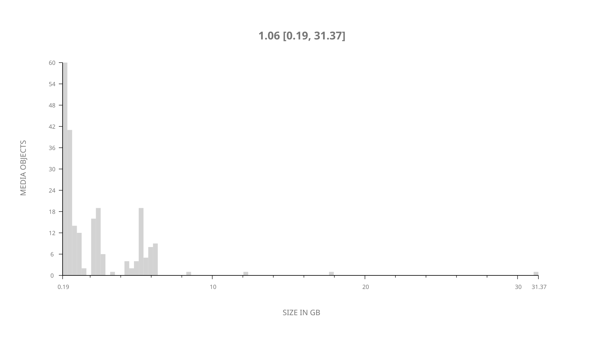
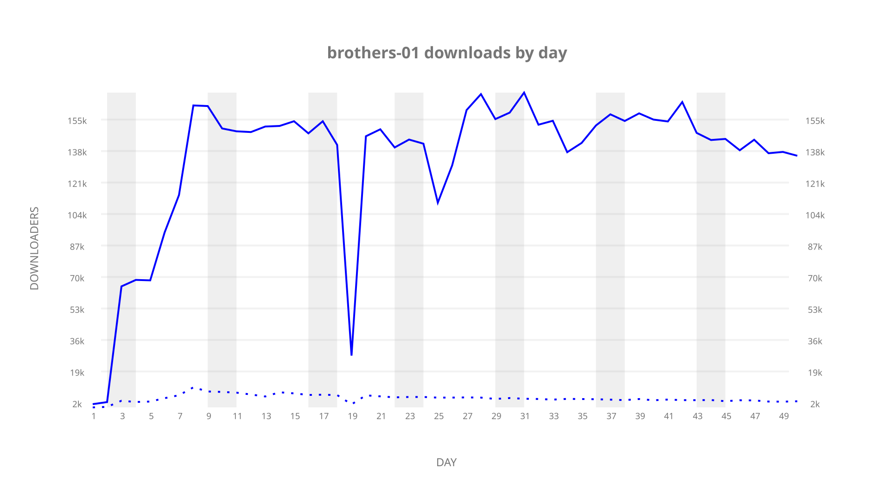
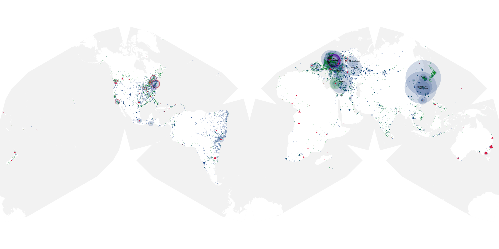
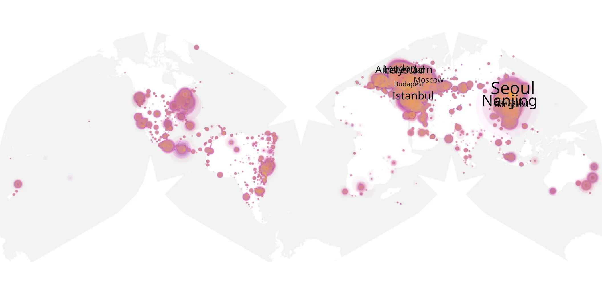
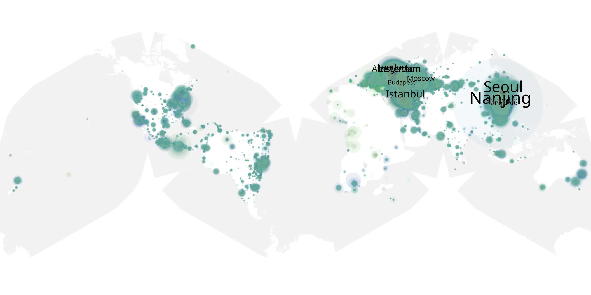

# brothers-01 sample cache audit

## 1. Media object

| Field | Value |
| --- | --- |
| Media object | Brothers |
| Collection key | `brothers-01` |
| imdb_id | [tt6773088](https://www.imdb.com/title/tt6773088/) |
| wikipedia_url | [Brothers (2026 TV series)](https://en.wikipedia.org/wiki/Brothers_(2026_TV_series)) |
| Sample dates | 2026-09-24-to-2026-11-13 |
| Sample days | 51 |
| BTIH count | 228 |
| Unique BTIH count | 226 |
| Downloaders total | 5,358,979 |
| Uploaders total | 146,914 |
| Data version | `2026-08-05` |
| IP geolocation version | `6:1777968300` |

## 2. Coverage report

- Generated: 2026-11-17T04:35:01Z
- Sample archive directory: `/mnt/gold/src/alpha60-samples-raw.gold/brothers-01.xz`
- Hour directories: 1160
- Zero-length sample files: 0
- Other unparsable sample files: 0
- Hourly discontinuities: 1 (46 missing hours)
- Missing days: 1

### Sample archive discontinuities

- hourly gap: last `2026-10-11 22:03`, resumed `2026-10-13 21:03` — missing 46 hour(s)
- missing day: `2026-10-12`

## 3. File sizes histogram *median[lowest, highest]*

## 4. Graphs

### Downloads by week cumulative (normalized start)



### Downloads by day, Saturday and Sunday in gray

## 5. Cumulative Maps

<!-- https://raw.githubusercontent.com/alpha60-devops/alpha60-results-2026/refs/heads/main/data/ -->

### <a href="https://raw.githubusercontent.com/alpha60-devops/alpha60-results-2026/refs/heads/main/data/geojson.cumulative/brothers-01-cumulative-aggregate.geojson.gz" data-map-title="Brothers — brothers-01" onclick="leaflet_map_open_window(this.href, this.dataset.mapTitle); return false;" class="table-link" aria-label="Open Brothers (brothers-01) cumulative data map in new window" title="Opens interactive map for Brothers (brothers-01) data">Swarm Detail</a>

### Geographic Regions

| Africa | Americas | Asia | Europe | Oceania | Unknown |
| --- | --- | --- | --- | --- | --- |
| 1.83 | 20.07 | 30.84 | 45.04 | 1.36 | 0.85 |

### Network infrastructure

{:target="_blank" rel="noopener"}

### Resolution >= 1080p

{:target="_blank" rel="noopener"}

### Resolution < 1080p

{:target="_blank" rel="noopener"}
