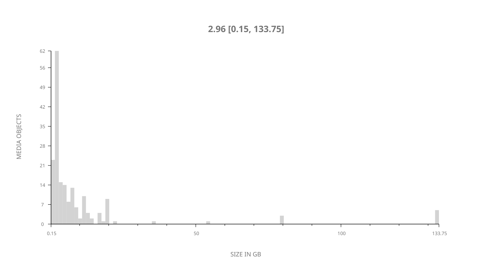
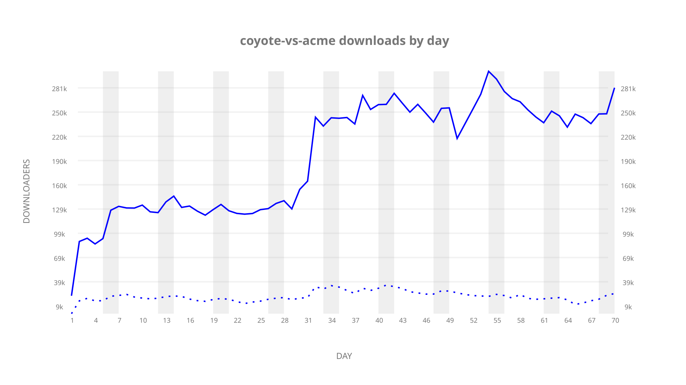
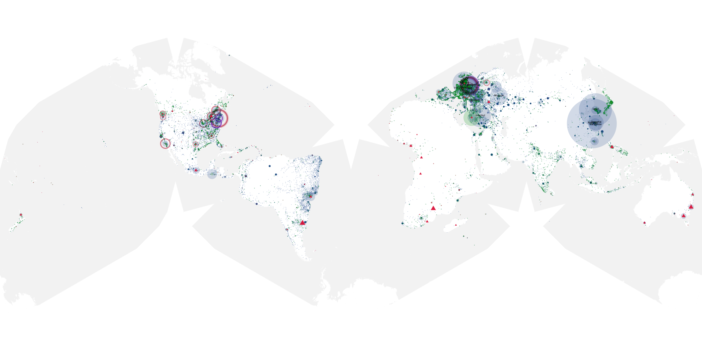
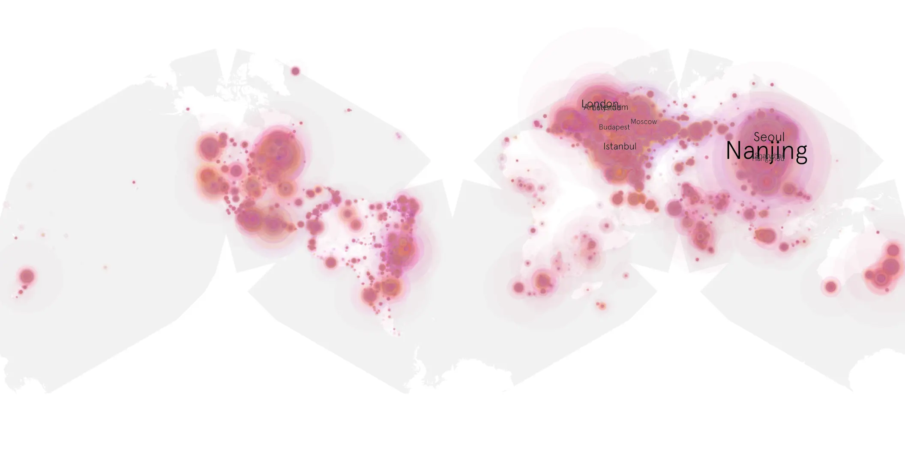
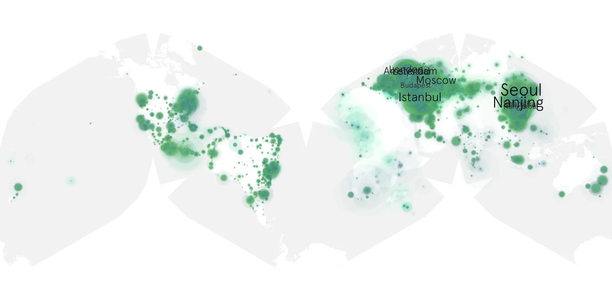

# coyote-vs-acme sample cache audit

## 1. Media object

| Field | Value |
| --- | --- |
| Media object | Coyote vs. Acme |
| Collection key | `coyote-vs-acme` |
| imdb_id | [tt1756855](https://www.imdb.com/title/tt1756855/) |
| wikipedia_url | [Coyote vs. Acme](https://en.wikipedia.org/wiki/Coyote_vs._Acme) |
| Sample dates | 2026-08-31-to-2026-11-08 |
| Sample days | 70 |
| BTIH count | 195 |
| Unique BTIH count | 184 |
| Downloaders total | 9,596,366 |
| Uploaders total | 932,331 |
| Data version | `2026-08-05` |
| IP geolocation version | `6:1777968300` |

## 2. Coverage report

- Generated: 2026-11-17T17:03:12Z
- Sample archive directory: `/mnt/gold/src/alpha60-samples-raw.gold/coyote-vs-acme.xz`
- Hour directories: 1672
- Other unparsable sample files: 0
- Hourly discontinuities: 0 (0 missing hours)
- Missing days: 0

### Sample archive discontinuities

None detected.

## 3. File sizes histogram *median[lowest, highest]*

## 4. Graphs

### Downloads by week cumulative (normalized start)



### Downloads by day, Saturday and Sunday in gray

## 5. Cumulative Maps

<!-- https://raw.githubusercontent.com/alpha60-devops/alpha60-results-2026/refs/heads/main/data/ -->

### <a href="https://raw.githubusercontent.com/alpha60-devops/alpha60-results-2026/refs/heads/main/data/geojson.cumulative/coyote-vs-acme-cumulative-aggregate.geojson.gz" data-map-title="Coyote vs. Acme — coyote-vs-acme" onclick="leaflet_map_open_window(this.href, this.dataset.mapTitle); return false;" class="table-link" aria-label="Open Coyote vs. Acme (coyote-vs-acme) cumulative data map in new window" title="Opens interactive map for Coyote vs. Acme (coyote-vs-acme) data">Swarm Detail</a>

### Geographic Regions

| Africa | Americas | Asia | Europe | Oceania | Unknown |
| --- | --- | --- | --- | --- | --- |
| 3.07 | 23.06 | 28.96 | 42.45 | 1.72 | 0.74 |

### Network infrastructure

{:target="_blank" rel="noopener"}

### Resolution >= 1080p

{:target="_blank" rel="noopener"}

### Resolution < 1080p

{:target="_blank" rel="noopener"}
