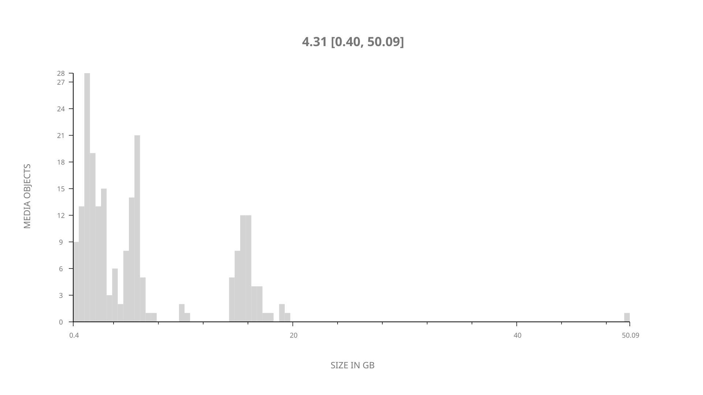
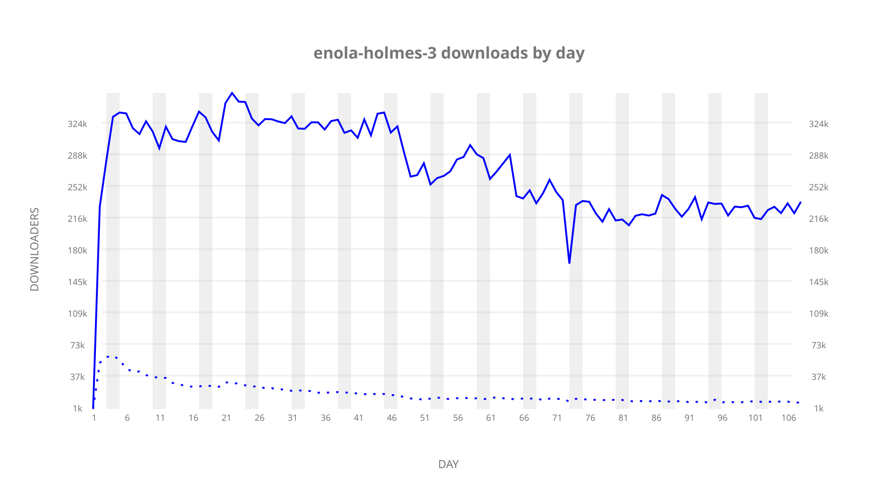
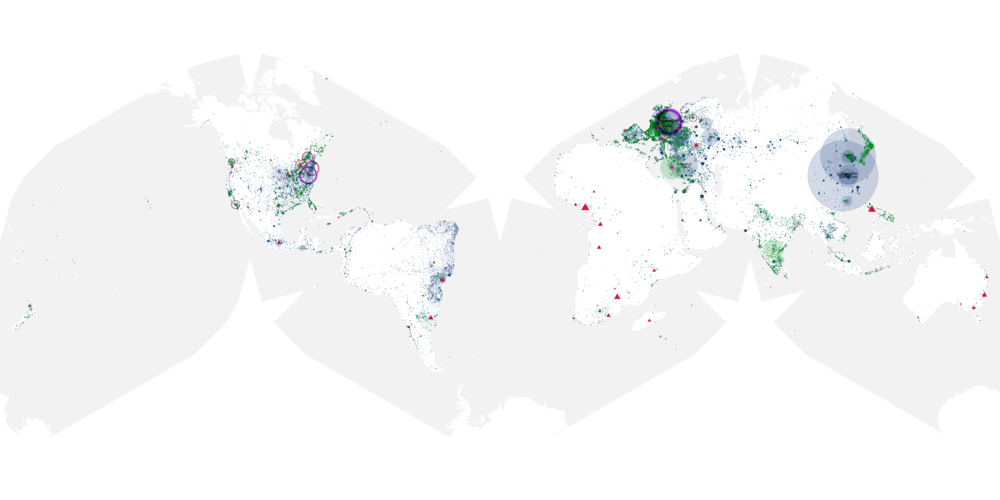
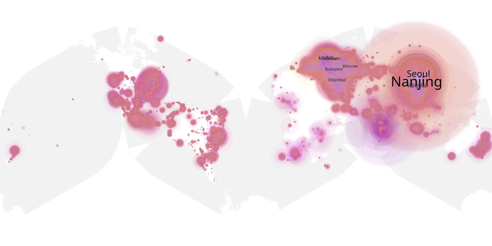
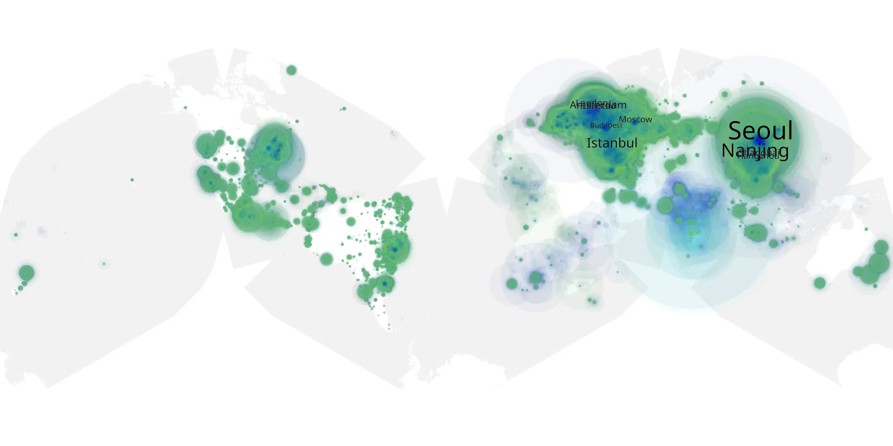

# enola-holmes-3 sample cache audit

## 1. Media object

| Field | Value |
| --- | --- |
| Media object | Enola Holmes 3 |
| Collection key | `enola-holmes-3` |
| imdb_id | [tt32278481](https://www.imdb.com/title/tt32278481/) |
| wikipedia_url | [Enola Holmes 3](https://en.wikipedia.org/wiki/Enola_Holmes_3) |
| Sample dates | 2026-07-01-to-2026-10-16 |
| Sample days | 108 |
| BTIH count | 227 |
| Unique BTIH count | 212 |
| Downloaders total | 22,152,046 |
| Uploaders total | 1,103,730 |
| Data version | `2026-08-05` |
| IP geolocation version | `6:1777968300` |

## 2. Coverage report

- Generated: 2026-11-20T00:11:41Z
- Sample archive directory: `/mnt/gold/src/alpha60-samples-raw.gold/enola-holmes-3.xz`
- Hour directories: 2561
- Other unparsable sample files: 0
- Hourly discontinuities: 2 (10 missing hours)
- Missing days: 0

### Sample archive discontinuities

- hourly gap: last `2026-08-30 22:02`, resumed `2026-08-31 00:02` — missing 1 hour(s)
- hourly gap: last `2026-09-10 22:02`, resumed `2026-09-11 08:02` — missing 9 hour(s)

## 3. File sizes histogram *median[lowest, highest]*

## 4. Graphs

### Downloads by week cumulative (normalized start)



### Downloads by day, Saturday and Sunday in gray

## 5. Cumulative Maps

<!-- https://raw.githubusercontent.com/alpha60-devops/alpha60-results-2026/refs/heads/main/data/ -->

### <a href="https://raw.githubusercontent.com/alpha60-devops/alpha60-results-2026/refs/heads/main/data/geojson.cumulative/enola-holmes-3-cumulative-aggregate.geojson.gz" data-map-title="Enola Holmes 3 — enola-holmes-3" onclick="leaflet_map_open_window(this.href, this.dataset.mapTitle); return false;" class="table-link" aria-label="Open Enola Holmes 3 (enola-holmes-3) cumulative data map in new window" title="Opens interactive map for Enola Holmes 3 (enola-holmes-3) data">Swarm Detail</a>

### Geographic Regions

| Africa | Americas | Asia | Europe | Oceania | Unknown |
| --- | --- | --- | --- | --- | --- |
| 1.94 | 17.69 | 36.69 | 41.74 | 1.10 | 0.84 |

### Network infrastructure

{:target="_blank" rel="noopener"}

### Resolution >= 1080p

{:target="_blank" rel="noopener"}

### Resolution < 1080p

{:target="_blank" rel="noopener"}
