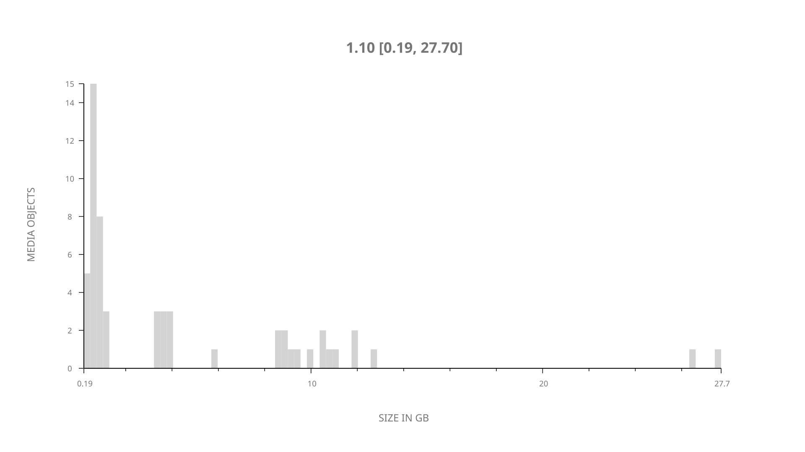
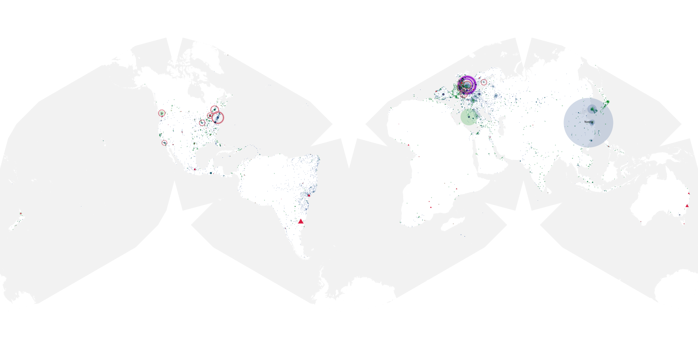
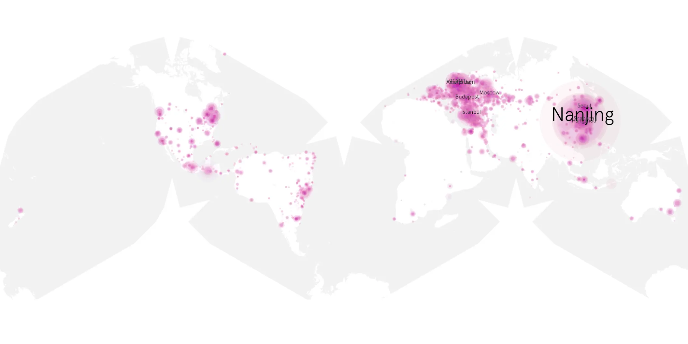
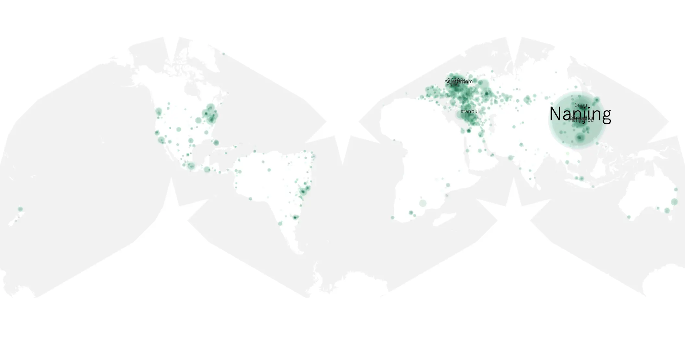

# fall-of-el-mayo-01 sample cache audit

## 1. Media object

| Field | Value |
| --- | --- |
| Media object | The Fall of El Mayo |
| Collection key | `fall-of-el-mayo-01` |
| imdb_id | [tt49250618](https://www.imdb.com/title/tt49250618/) |
| wikipedia_url | UNAVAILABLE — no English Wikipedia page exists |
| Sample dates | 2026-10-30-to-2026-11-13 |
| Sample days | 15 |
| BTIH count | 57 |
| Unique BTIH count | 57 |
| Downloaders total | 473,349 |
| Uploaders total | 16,013 |
| Data version | `2026-08-05` |
| IP geolocation version | `6:1777968300` |

## 2. Coverage report

- Generated: 2026-11-16T19:55:52Z
- Sample archive directory: `/mnt/gold/src/alpha60-samples-raw.gold/fall-of-el-mayo-01.xz`
- Hour directories: 359
- Other unparsable sample files: 0
- Hourly discontinuities: 0 (0 missing hours)
- Missing days: 0

### Sample archive discontinuities

None detected.

## 3. File sizes histogram *median[lowest, highest]*

## 4. Graphs

### Downloads by week cumulative (normalized start)



### Downloads by day, Saturday and Sunday in gray

## 5. Cumulative Maps

<!-- https://raw.githubusercontent.com/alpha60-devops/alpha60-results-2026/refs/heads/main/data/ -->

### <a href="https://raw.githubusercontent.com/alpha60-devops/alpha60-results-2026/refs/heads/main/data/geojson.cumulative/fall-of-el-mayo-01-cumulative-aggregate.geojson.gz" data-map-title="The Fall of El Mayo — fall-of-el-mayo-01" onclick="leaflet_map_open_window(this.href, this.dataset.mapTitle); return false;" class="table-link" aria-label="Open The Fall of El Mayo (fall-of-el-mayo-01) cumulative data map in new window" title="Opens interactive map for The Fall of El Mayo (fall-of-el-mayo-01) data">Swarm Detail</a>

### Geographic Regions

| Africa | Americas | Asia | Europe | Oceania | Unknown |
| --- | --- | --- | --- | --- | --- |
| 1.65 | 17.57 | 39.77 | 39.25 | 1.03 | 0.73 |

### Network infrastructure

{:target="_blank" rel="noopener"}

### Resolution >= 1080p

{:target="_blank" rel="noopener"}

### Resolution < 1080p

{:target="_blank" rel="noopener"}
