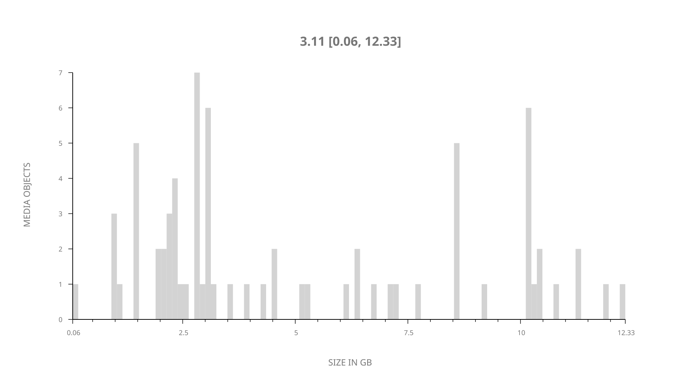
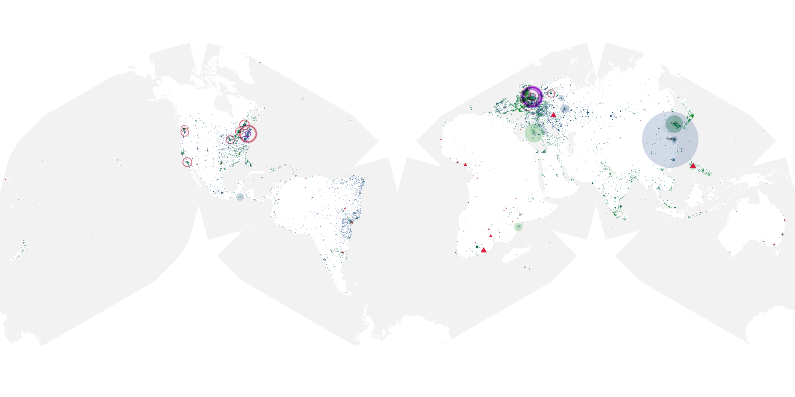
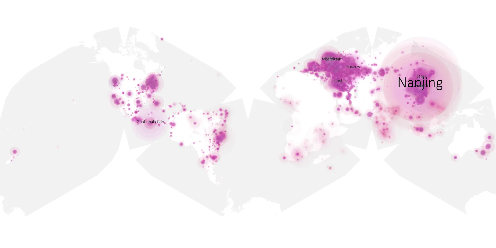
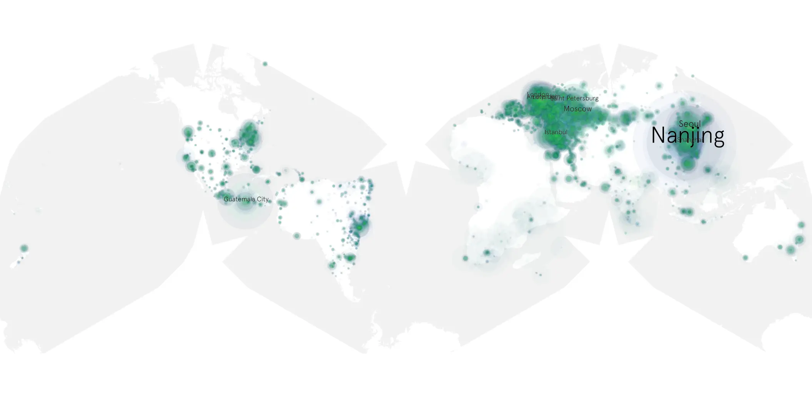

# hopeu-2026 sample cache audit

## 1. Media object

| Field | Value |
| --- | --- |
| Media object | Hope |
| Collection key | `hopeu-2026` |
| imdb_id | [tt27369017](https://www.imdb.com/title/tt27369017/) |
| wikipedia_url | [Hope (2026 film)](https://en.wikipedia.org/wiki/Hope_(2026_film)) |
| Sample dates | 2026-10-24-to-2026-11-14 |
| Sample days | 22 |
| BTIH count | 79 |
| Unique BTIH count | 72 |
| Downloaders total | 1,811,058 |
| Uploaders total | 292,343 |
| Data version | `2026-08-05` |
| IP geolocation version | `6:1777968300` |

## 2. Coverage report

- Generated: 2026-11-16T19:59:01Z
- Sample archive directory: `/mnt/gold/src/alpha60-samples-raw.gold/hopeu-2026.xz`
- Hour directories: 523
- Other unparsable sample files: 0
- Hourly discontinuities: 1 (1 missing hours)
- Missing days: 0

### Sample archive discontinuities

- hourly gap: last `2026-11-08 22:06`, resumed `2026-11-09 00:06` — missing 1 hour(s)

## 3. File sizes histogram *median[lowest, highest]*

## 4. Graphs

### Downloads by week cumulative (normalized start)



### Downloads by day, Saturday and Sunday in gray

## 5. Cumulative Maps

<!-- https://raw.githubusercontent.com/alpha60-devops/alpha60-results-2026/refs/heads/main/data/ -->

### <a href="https://raw.githubusercontent.com/alpha60-devops/alpha60-results-2026/refs/heads/main/data/geojson.cumulative/hopeu-2026-cumulative-aggregate.geojson.gz" data-map-title="Hope — hopeu-2026" onclick="leaflet_map_open_window(this.href, this.dataset.mapTitle); return false;" class="table-link" aria-label="Open Hope (hopeu-2026) cumulative data map in new window" title="Opens interactive map for Hope (hopeu-2026) data">Swarm Detail</a>

### Geographic Regions

| Africa | Americas | Asia | Europe | Oceania | Unknown |
| --- | --- | --- | --- | --- | --- |
| 4.07 | 18.08 | 36.69 | 39.24 | 1.15 | 0.76 |

### Network infrastructure

{:target="_blank" rel="noopener"}

### Resolution >= 1080p

{:target="_blank" rel="noopener"}

### Resolution < 1080p

{:target="_blank" rel="noopener"}
