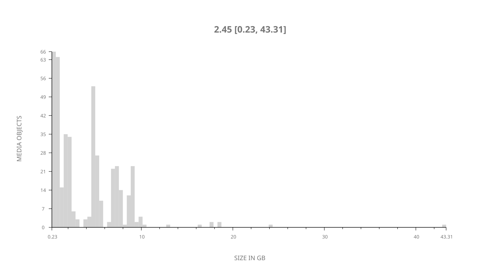
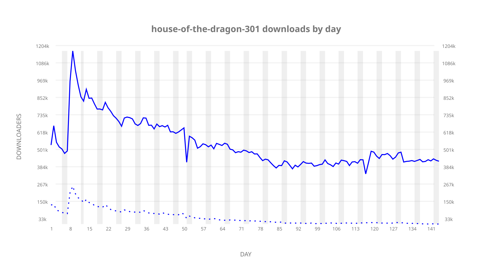
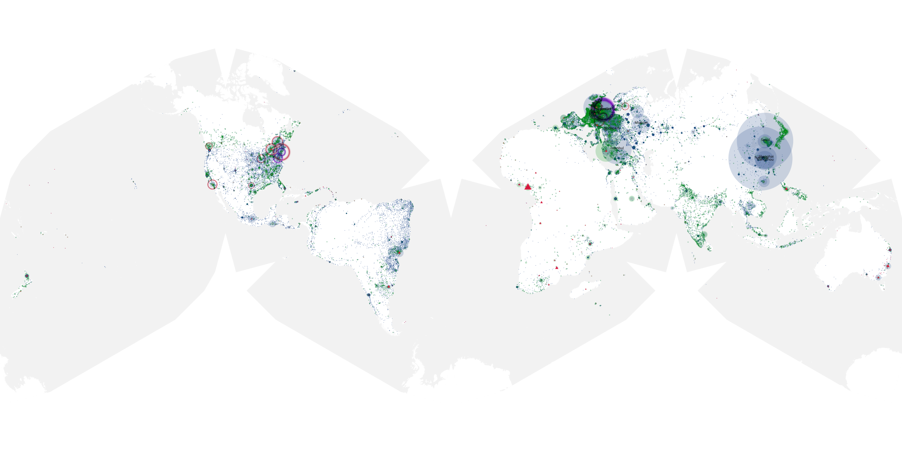
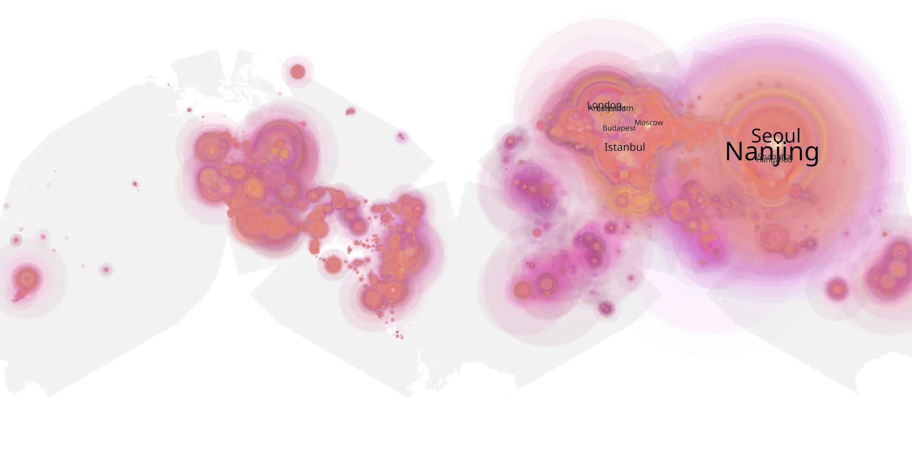
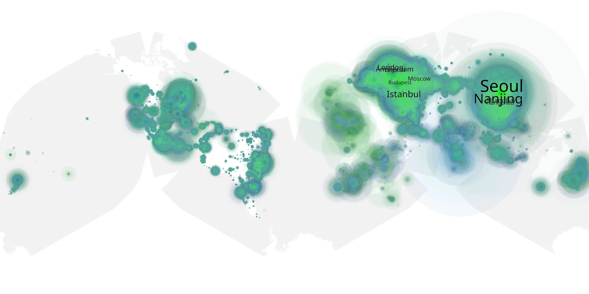

# house-of-the-dragon-301 sample cache audit

## 1. Media object

| Field | Value |
| --- | --- |
| Media object | House of the Dragon |
| Collection key | `house-of-the-dragon-301` |
| imdb_id | [tt11198330](https://www.imdb.com/title/tt11198330/) |
| wikipedia_url | [House of the Dragon](https://en.wikipedia.org/wiki/House_of_the_Dragon) |
| Sample dates | 2026-06-22-to-2026-11-15 |
| Sample days | 147 |
| BTIH count | 448 |
| Unique BTIH count | 432 |
| Downloaders total | 54,845,668 |
| Uploaders total | 4,723,193 |
| Data version | `2026-08-05` |
| IP geolocation version | `6:1777968300` |

## 2. Coverage report

- Generated: 2026-11-20T08:14:50Z
- Sample archive directory: `/home/bkoz/src/alpha60-campaigns/year-2026/20261116-v8/objects/house-of-the-dragon-301/g2/results/coverage-inputs`
- Hour directories: 3442
- Zero-length sample files: 0
- Other unparsable sample files: 0
- Hourly discontinuities: 3 (83 missing hours)
- Missing days: 3

### Sample archive discontinuities

- hourly gap: last `2026-07-03 22:05`, resumed `2026-07-05 01:05` — missing 26 hour(s)
- hourly gap: last `2026-07-19 13:05`, resumed `2026-07-19 15:05` — missing 1 hour(s)
- hourly gap: last `2026-08-12 15:05`, resumed `2026-08-15 00:05` — missing 56 hour(s)
- missing day: `2026-07-04`
- missing day: `2026-08-13`
- missing day: `2026-08-14`

## 3. File sizes histogram *median[lowest, highest]*

## 4. Graphs

### Downloads by week cumulative (normalized start)



### Downloads by day, Saturday and Sunday in gray

## 5. Cumulative Maps

<!-- https://raw.githubusercontent.com/alpha60-devops/alpha60-results-2026/refs/heads/main/data/ -->

### <a href="https://raw.githubusercontent.com/alpha60-devops/alpha60-results-2026/refs/heads/main/data/geojson.cumulative/house-of-the-dragon-301-cumulative-aggregate.geojson.gz" data-map-title="House of the Dragon — house-of-the-dragon-301" onclick="leaflet_map_open_window(this.href, this.dataset.mapTitle); return false;" class="table-link" aria-label="Open House of the Dragon (house-of-the-dragon-301) cumulative data map in new window" title="Opens interactive map for House of the Dragon (house-of-the-dragon-301) data">Swarm Detail</a>

### Geographic Regions

| Africa | Americas | Asia | Europe | Oceania | Unknown |
| --- | --- | --- | --- | --- | --- |
| 3.15 | 18.43 | 34.24 | 41.87 | 1.50 | 0.82 |

### Network infrastructure

{:target="_blank" rel="noopener"}

### Resolution >= 1080p

{:target="_blank" rel="noopener"}

### Resolution < 1080p

{:target="_blank" rel="noopener"}

<!-- BEGIN alpha60-v8-source-dispositions -->

## Recovered and skipped source samples

A mislabeled archive duplicated an earlier capture. Its labeled hour is omitted from the analysis and the original archive is preserved.
The sample-date range does not establish complete observations in the affected hours. No missing observations were fabricated.

| Source archive | Disposition | Valid JSON files recovered |
| --- | --- | ---: |
| `2026-07-19-at-14-05.tar.xz` | Omitted duplicate of `2026-07-06-at-03-05.tar.xz` | 0 |

[Source dispositions and archive hashes](../../data/txt/year-2026-source-dispositions/house-of-the-dragon-301.json).

<!-- END alpha60-v8-source-dispositions -->
