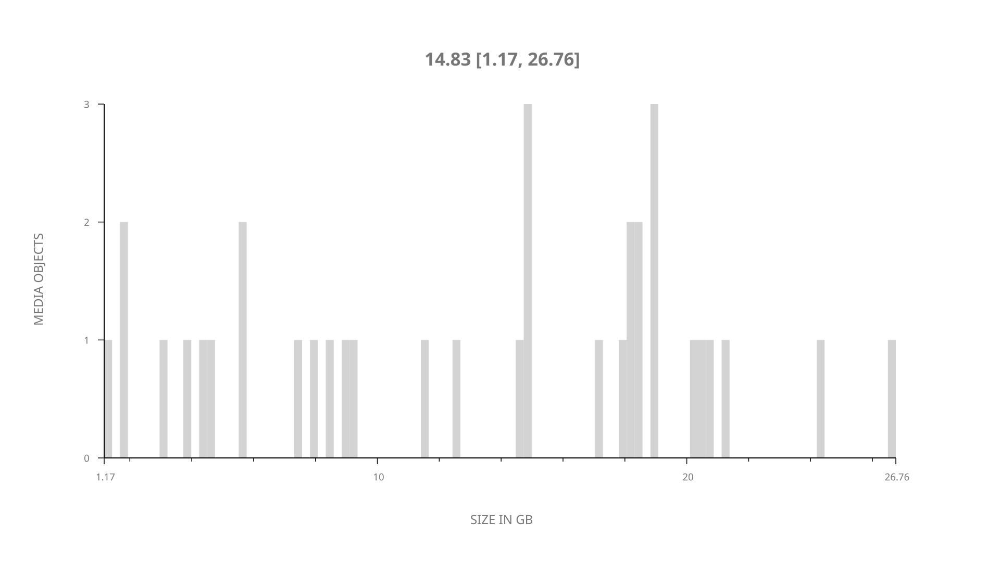
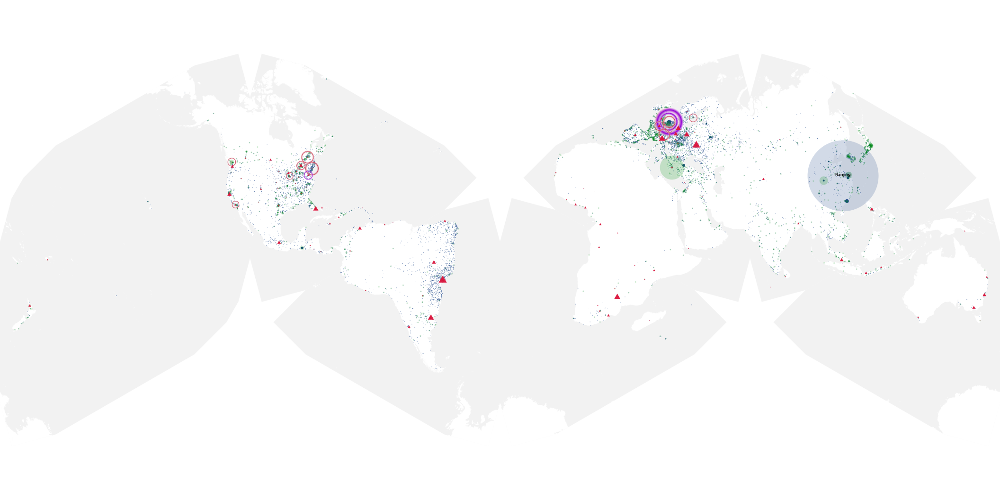
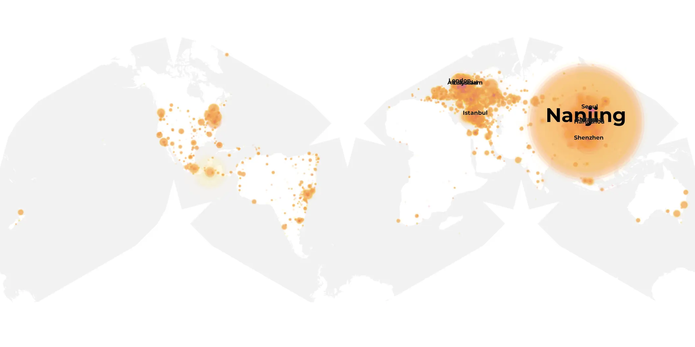
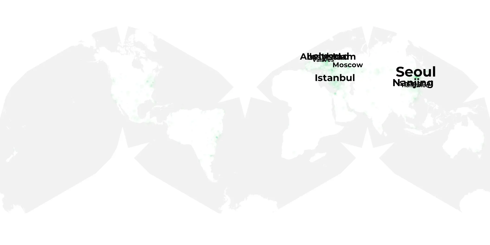

# kung-fu-soccer-2026 sample cache audit

## 1. Media object

| Field | Value |
| --- | --- |
| Media object | Kung Fu Soccer |
| Collection key | `kung-fu-soccer-2026` |
| imdb_id | UNAVAILABLE |
| wikipedia_url | UNAVAILABLE — no English Wikipedia page exists |
| Sample dates | 2026-10-03-to-2026-10-30 |
| Sample days | 28 |
| BTIH count | 36 |
| Unique BTIH count | 35 |
| Downloaders total | 1,494,410 |
| Uploaders total | 239,339 |
| Data version | `2026-08-05` |
| IP geolocation version | `6:1777968300` |

## 2. Coverage report

- Generated: 2026-11-06T05:07:54Z
- Sample archive directory: `/mnt/gold/src/alpha60-samples-raw.gold/kung-fu-soccer-2026.xz`
- Hour directories: 652
- Zero-length sample files: 0
- Other unparsable sample files: 0
- Hourly discontinuities: 0 (0 missing hours)
- Missing days: 0

### Sample archive discontinuities

None detected.

### Validation scope

- Validated sample window: 2026-10-03 through 2026-10-30.
- Raw JSON members parsed: 289372.
- This scan checks raw JSON syntax and the archive timeline; collection filtering and cache production are separate steps.
- Raw validation receipt SHA-256: `aa7567664f6f467b5fbbc59de77f72ce80c1a00e939c68a8f8793bac26d36e17`.
- Raw source archives and supplied cache archives were read without modification.

### Cache snapshot evidence

- `cache.20261030.tar.xz` SHA-256: `dd0b4ba72f67708e07ceef5aa72de740a7cbc98700f7d9253fe8c55940797f43`.
- `tmp.tar.xz` SHA-256: `8f68bf6c7a3f810ed838e50c53d0a295c835e2d556857022def2e61338cb2ffc`.
- Validated daily JSON/GeoJSON pairs: 28.
- Cumulative downloader and uploader totals reconcile with the supplied per-torrent cumulative cache records.
- [Raw-source validation](https://github.com/alpha60-devops/alpha60-results-2026/blob/main/data/txt/results-pages-20261105/kung-fu-soccer-2026/raw-validation.json) and [cache validation](https://github.com/alpha60-devops/alpha60-results-2026/blob/main/data/txt/results-pages-20261105/kung-fu-soccer-2026/cache-validation.json).

## 3. File sizes histogram *median[lowest, highest]*

## 4. Graphs

### Downloads by week cumulative (normalized start)



### Downloads by day, Saturday and Sunday in gray

## 5. Cumulative Maps

<!-- https://raw.githubusercontent.com/alpha60-devops/alpha60-results-2026/refs/heads/main/data/ -->

### <a href="https://raw.githubusercontent.com/alpha60-devops/alpha60-results-2026/refs/heads/main/data/geojson.cumulative/kung-fu-soccer-2026-cumulative-aggregate.geojson.gz" data-map-title="Kung Fu Soccer — kung-fu-soccer-2026" onclick="leaflet_map_open_window(this.href, this.dataset.mapTitle); return false;" class="table-link" aria-label="Open Kung Fu Soccer (kung-fu-soccer-2026) cumulative data map in new window" title="Opens interactive map for Kung Fu Soccer (kung-fu-soccer-2026) data">Swarm Detail</a>

### Geographic Regions

| Africa | Americas | Asia | Europe | Oceania | Unknown |
| --- | --- | --- | --- | --- | --- |
| 0.79 | 11.79 | 58.26 | 27.65 | 0.65 | 0.85 |

### Network infrastructure

{:target="_blank" rel="noopener"}

### Resolution >= 1080p

{:target="_blank" rel="noopener"}

### Resolution < 1080p

{:target="_blank" rel="noopener"}
