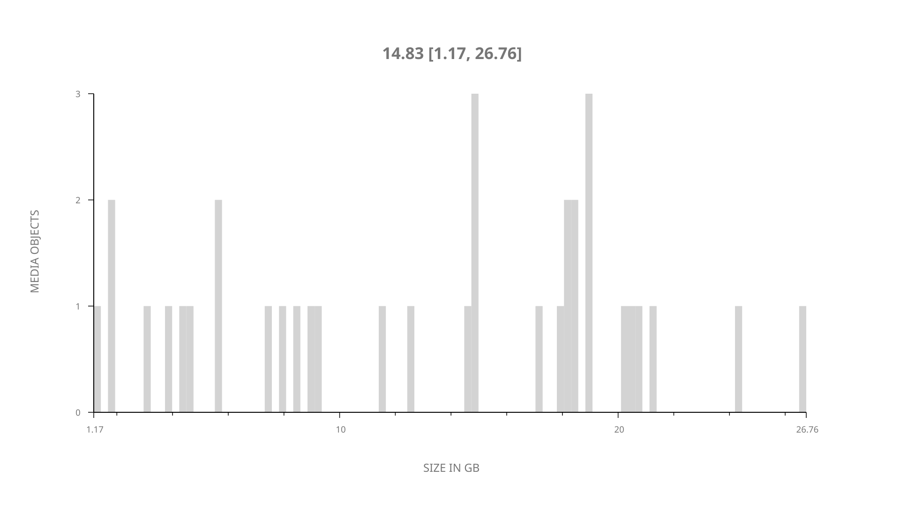
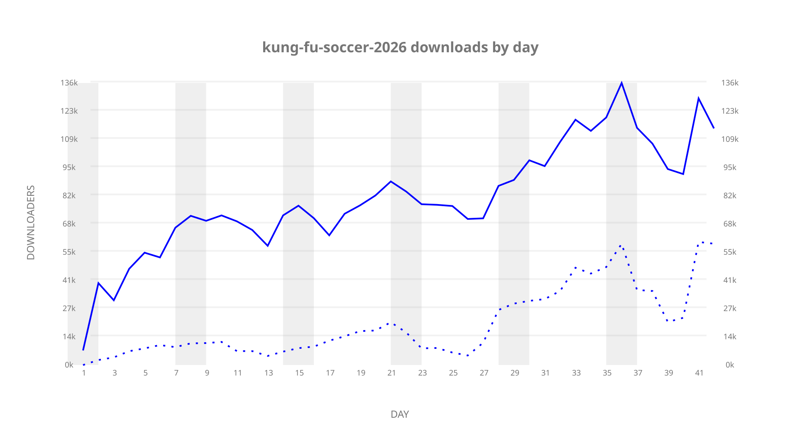
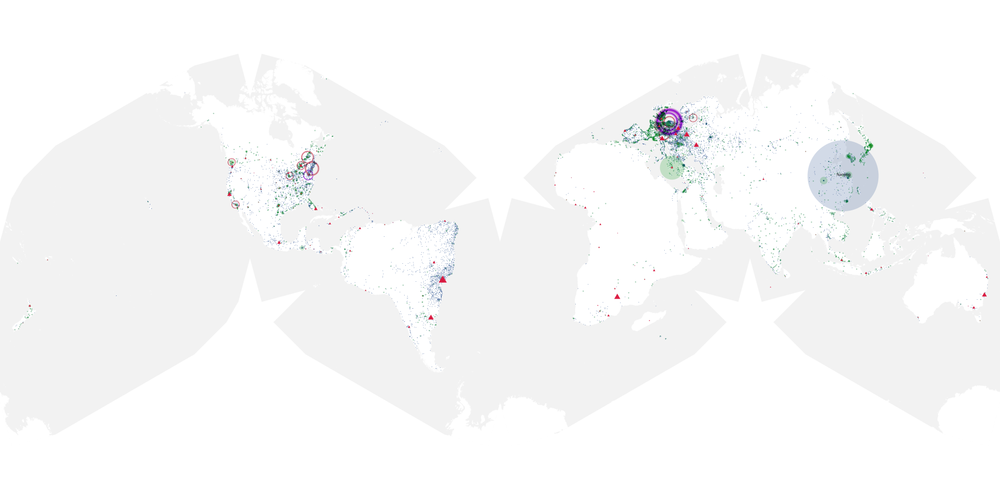
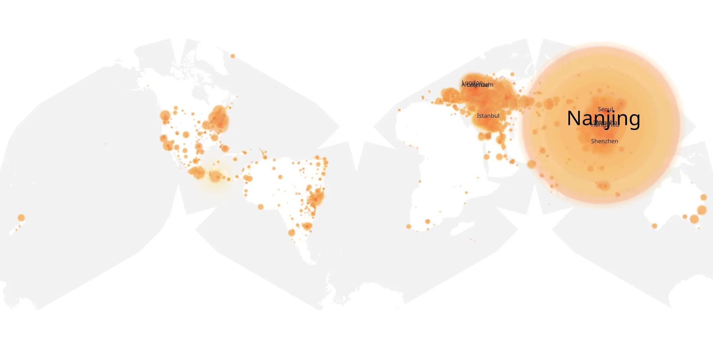
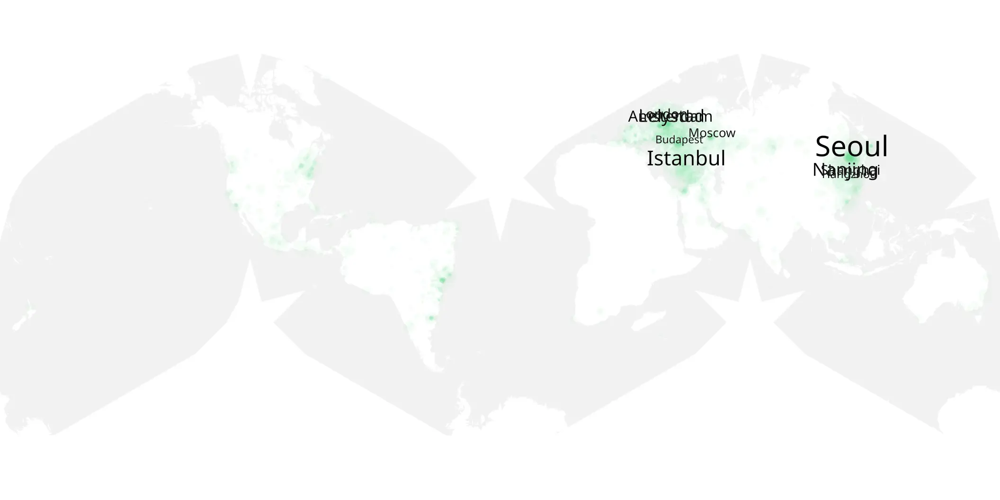

# kung-fu-soccer-2026 sample cache audit

## 1. Media object

| Field | Value |
| --- | --- |
| Media object | Kung Fu Soccer |
| Collection key | `kung-fu-soccer-2026` |
| imdb_id | [tt36103784](https://www.imdb.com/title/tt36103784/) |
| wikipedia_url | [Kung Fu Soccer (film)](https://en.wikipedia.org/wiki/Kung_Fu_Soccer_(film)) |
| Sample dates | 2026-10-03-to-2026-11-13 |
| Sample days | 42 |
| BTIH count | 36 |
| Unique BTIH count | 35 |
| Downloaders total | 2,458,936 |
| Uploaders total | 583,973 |
| Data version | `2026-08-05` |
| IP geolocation version | `6:1777968300` |

## 2. Coverage report

- Generated: 2026-11-19T01:51:44Z
- Sample archive directory: `/mnt/gold/src/alpha60-samples-raw.gold/kung-fu-soccer-2026.xz`
- Hour directories: 988
- Zero-length sample files: 0
- Other unparsable sample files: 0
- Hourly discontinuities: 0 (0 missing hours)
- Missing days: 0

### Sample archive discontinuities

None detected.

## 3. File sizes histogram *median[lowest, highest]*

## 4. Graphs

### Downloads by week cumulative (normalized start)



### Downloads by day, Saturday and Sunday in gray

## 5. Cumulative Maps

<!-- https://raw.githubusercontent.com/alpha60-devops/alpha60-results-2026/refs/heads/main/data/ -->

### <a href="https://raw.githubusercontent.com/alpha60-devops/alpha60-results-2026/refs/heads/main/data/geojson.cumulative/kung-fu-soccer-2026-cumulative-aggregate.geojson.gz" data-map-title="Kung Fu Soccer — kung-fu-soccer-2026" onclick="leaflet_map_open_window(this.href, this.dataset.mapTitle); return false;" class="table-link" aria-label="Open Kung Fu Soccer (kung-fu-soccer-2026) cumulative data map in new window" title="Opens interactive map for Kung Fu Soccer (kung-fu-soccer-2026) data">Swarm Detail</a>

### Geographic Regions

| Africa | Americas | Asia | Europe | Oceania | Unknown |
| --- | --- | --- | --- | --- | --- |
| 0.82 | 11.26 | 60.38 | 26.18 | 0.61 | 0.75 |

### Network infrastructure

{:target="_blank" rel="noopener"}

### Resolution >= 1080p

{:target="_blank" rel="noopener"}

### Resolution < 1080p

{:target="_blank" rel="noopener"}
