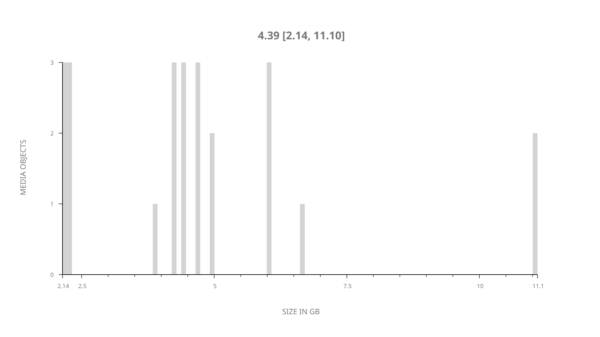
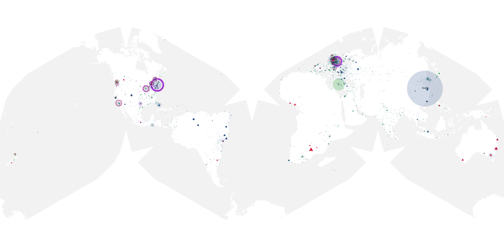
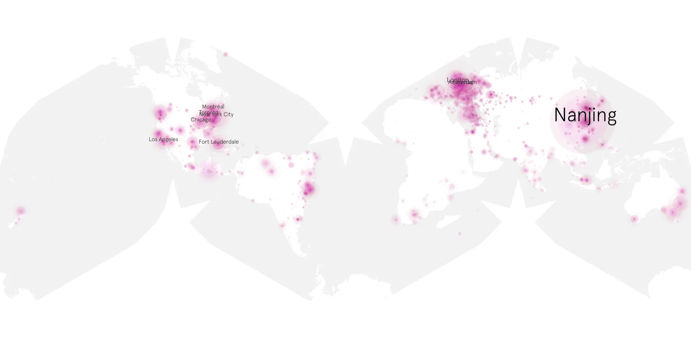
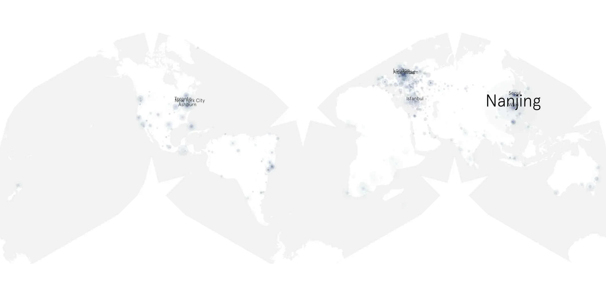

# musk-2026 sample cache audit

## 1. Media object

| Field | Value |
| --- | --- |
| Media object | Musk |
| Collection key | `musk-2026` |
| imdb_id | [tt27041231](https://www.imdb.com/title/tt27041231/) |
| wikipedia_url | [Musk (film)](https://en.wikipedia.org/wiki/Musk_(film)) |
| Sample dates | 2026-11-07-to-2026-11-13 |
| Sample days | 7 |
| BTIH count | 24 |
| Unique BTIH count | 24 |
| Downloaders total | 233,284 |
| Uploaders total | 60,235 |
| Data version | `2026-08-05` |
| IP geolocation version | `6:1777968300` |

## 2. Coverage report

- Generated: 2026-11-16T18:57:31Z
- Sample archive directory: `/mnt/gold/src/alpha60-samples-raw.gold/musk-2026.xz`
- Hour directories: 167
- Zero-length sample files: 0
- Other unparsable sample files: 0
- Hourly discontinuities: 1 (1 missing hours)
- Missing days: 0

### Sample archive discontinuities

- hourly gap: last `2026-11-08 22:05`, resumed `2026-11-09 00:05` — missing 1 hour(s)

## 3. File sizes histogram *median[lowest, highest]*

## 4. Graphs

### Downloads by week cumulative (normalized start)



### Downloads by day, Saturday and Sunday in gray

## 5. Cumulative Maps

<!-- https://raw.githubusercontent.com/alpha60-devops/alpha60-results-2026/refs/heads/main/data/ -->

### <a href="https://raw.githubusercontent.com/alpha60-devops/alpha60-results-2026/refs/heads/main/data/geojson.cumulative/musk-2026-cumulative-aggregate.geojson.gz" data-map-title="Musk — musk-2026" onclick="leaflet_map_open_window(this.href, this.dataset.mapTitle); return false;" class="table-link" aria-label="Open Musk (musk-2026) cumulative data map in new window" title="Opens interactive map for Musk (musk-2026) data">Swarm Detail</a>

### Geographic Regions

| Africa | Americas | Asia | Europe | Oceania | Unknown |
| --- | --- | --- | --- | --- | --- |
| 3.50 | 32.00 | 26.66 | 33.56 | 3.91 | 0.37 |

### Network infrastructure

{:target="_blank" rel="noopener"}

### Resolution >= 1080p

{:target="_blank" rel="noopener"}

### Resolution < 1080p

{:target="_blank" rel="noopener"}
