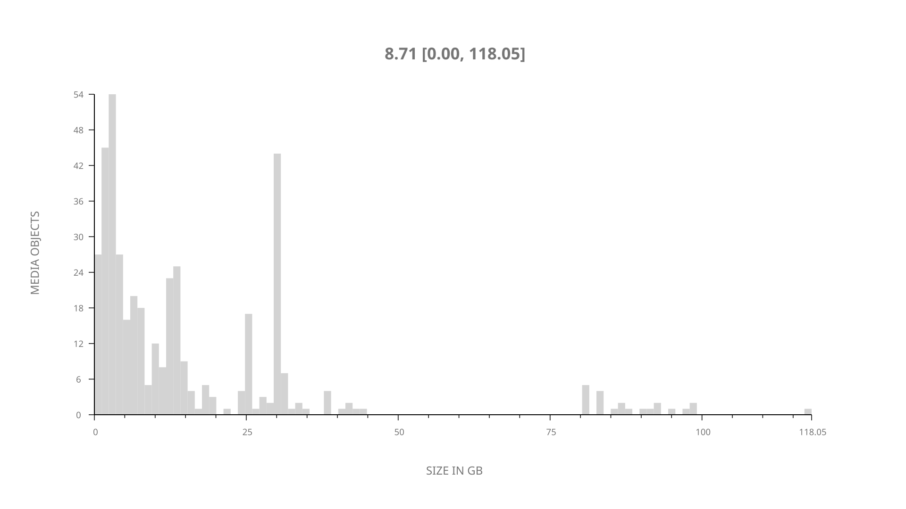
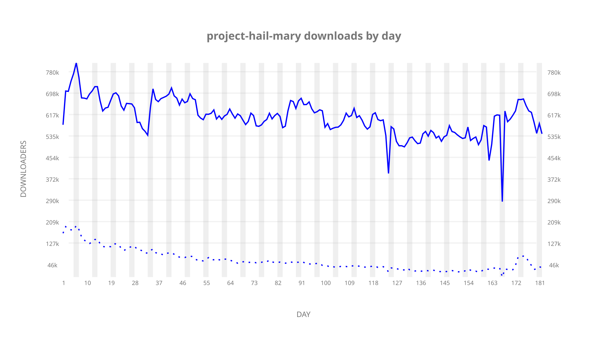
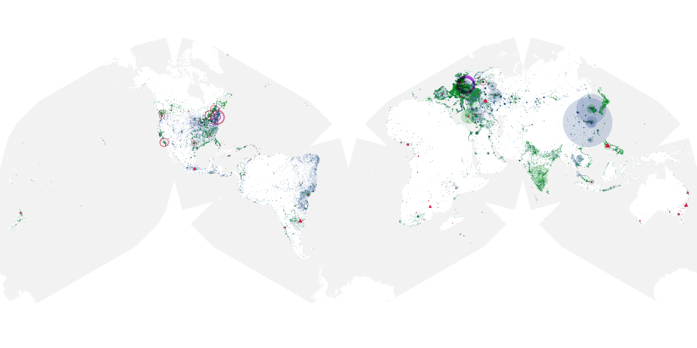
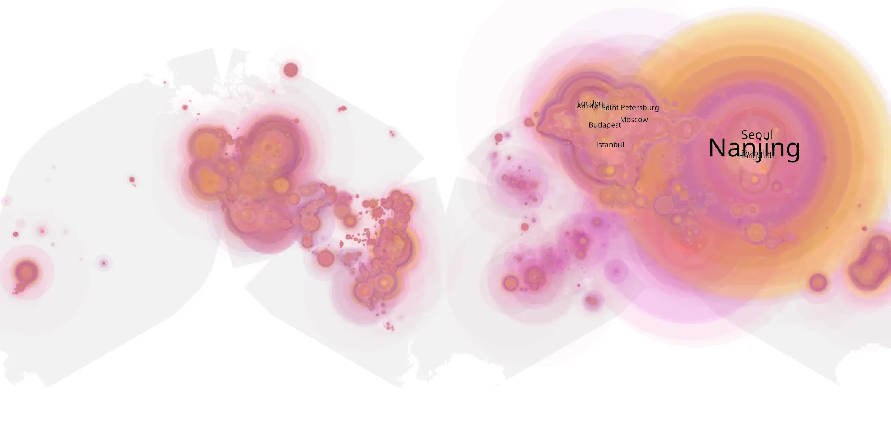
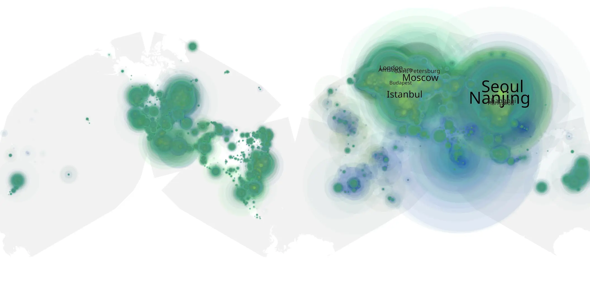

# project-hail-mary sample cache audit

## 1. Media object

| Field | Value |
| --- | --- |
| Media object | Project Hail Mary |
| Collection key | `project-hail-mary` |
| imdb_id | [tt12042730](https://www.imdb.com/title/tt12042730/) |
| wikipedia_url | [Project Hail Mary (film)](https://en.wikipedia.org/wiki/Project_Hail_Mary_(film)) |
| Sample dates | 2026-05-11-to-2026-11-08 |
| Sample days | 182 |
| BTIH count | 452 |
| Unique BTIH count | 416 |
| Downloaders total | 78,029,387 |
| Uploaders total | 9,103,613 |
| Data version | `2026-08-05` |
| IP geolocation version | `6:1777968300` |

## 2. Coverage report

- Generated: 2026-11-19T14:19:05Z
- Sample archive directory: `/home/bkoz/src/alpha60-campaigns/year-2026/20261116-v8/objects/project-hail-mary/g1/results/coverage-inputs`
- Hour directories: 4334
- Zero-length sample files: 0
- Other unparsable sample files: 0
- Hourly discontinuities: 5 (27 missing hours)
- Missing days: 0

### Sample archive discontinuities

- hourly gap: last `2026-06-02 22:03`, resumed `2026-06-03 02:03` — missing 3 hour(s)
- hourly gap: last `2026-06-12 22:03`, resumed `2026-06-13 00:03` — missing 1 hour(s)
- hourly gap: last `2026-08-30 22:03`, resumed `2026-08-31 00:03` — missing 1 hour(s)
- hourly gap: last `2026-09-10 22:03`, resumed `2026-09-11 08:03` — missing 9 hour(s)
- hourly gap: last `2026-10-24 10:03`, resumed `2026-10-25 00:03` — missing 13 hour(s)

## 3. File sizes histogram *median[lowest, highest]*

## 4. Graphs

### Downloads by week cumulative (normalized start)



### Downloads by day, Saturday and Sunday in gray

## 5. Cumulative Maps

<!-- https://raw.githubusercontent.com/alpha60-devops/alpha60-results-2026/refs/heads/main/data/ -->

### <a href="https://raw.githubusercontent.com/alpha60-devops/alpha60-results-2026/refs/heads/main/data/geojson.cumulative/project-hail-mary-cumulative-aggregate.geojson.gz" data-map-title="Project Hail Mary — project-hail-mary" onclick="leaflet_map_open_window(this.href, this.dataset.mapTitle); return false;" class="table-link" aria-label="Open Project Hail Mary (project-hail-mary) cumulative data map in new window" title="Opens interactive map for Project Hail Mary (project-hail-mary) data">Swarm Detail</a>

### Geographic Regions

| Africa | Americas | Asia | Europe | Oceania | Unknown |
| --- | --- | --- | --- | --- | --- |
| 2.15 | 17.21 | 37.42 | 41.07 | 1.31 | 0.84 |

### Network infrastructure

{:target="_blank" rel="noopener"}

### Resolution >= 1080p

{:target="_blank" rel="noopener"}

### Resolution < 1080p

{:target="_blank" rel="noopener"}

<!-- BEGIN alpha60-v8-source-dispositions -->

## Recovered and skipped source samples

1 damaged source archives yielded 3,462 complete, valid JSON sample files; 0 archives yielded none and were skipped.
Recovered files were retained only after complete JSON validation and archive readback. Damaged original archives remain preserved.
**These source hours are not fully recovered. Lost original membership is unknown.**
The sample-date range does not establish complete observations in the affected hours. No missing observations were fabricated.

| Source archive | Disposition | Valid JSON files recovered |
| --- | --- | ---: |
| `2026-10-24-at-10-03.tar.xz` | partial-recovery | 3,462 |

[Source dispositions and archive hashes](../../data/txt/year-2026-source-dispositions/project-hail-mary.json).

<!-- END alpha60-v8-source-dispositions -->
