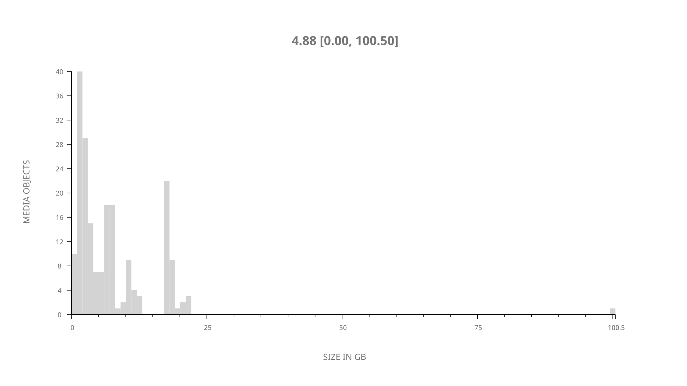
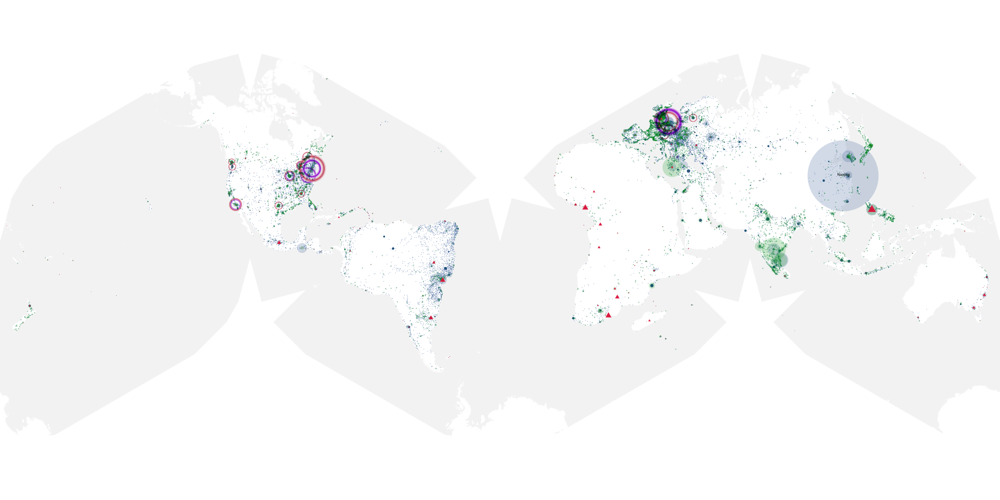
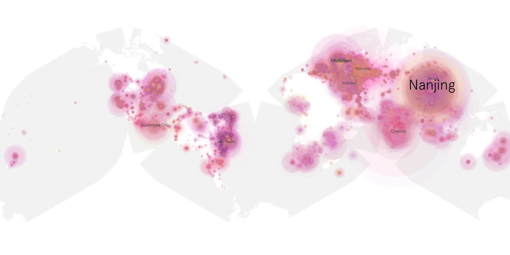
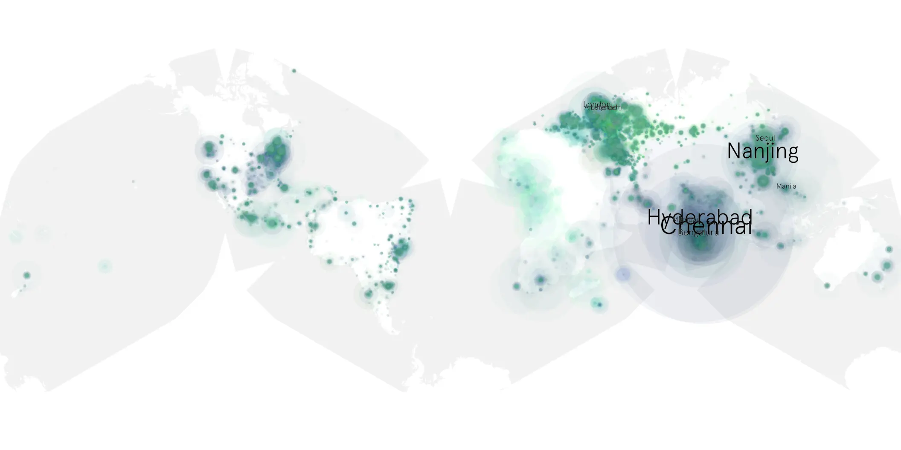

# resident-evil-2026 sample cache audit

## 1. Media object

| Field | Value |
| --- | --- |
| Media object | Resident Evil |
| Collection key | `resident-evil-2026` |
| imdb_id | [tt35538033](https://www.imdb.com/title/tt35538033/) |
| wikipedia_url | [Resident Evil (2026 film)](https://en.wikipedia.org/wiki/Resident_Evil_(2026_film)) |
| Sample dates | 2026-11-03-to-2026-11-13 |
| Sample days | 11 |
| BTIH count | 209 |
| Unique BTIH count | 201 |
| Downloaders total | 5,014,992 |
| Uploaders total | 1,148,624 |
| Data version | `2026-08-05` |
| IP geolocation version | `6:1777968300` |

## 2. Coverage report

- Generated: 2026-11-16T19:50:31Z
- Sample archive directory: `/mnt/gold/src/alpha60-samples-raw.gold/resident-evil-2026.xz`
- Hour directories: 258
- Other unparsable sample files: 0
- Hourly discontinuities: 0 (0 missing hours)
- Missing days: 0

### Sample archive discontinuities

None detected.

## 3. File sizes histogram *median[lowest, highest]*

## 4. Graphs

### Downloads by week cumulative (normalized start)



### Downloads by day, Saturday and Sunday in gray

## 5. Cumulative Maps

<!-- https://raw.githubusercontent.com/alpha60-devops/alpha60-results-2026/refs/heads/main/data/ -->

### <a href="https://raw.githubusercontent.com/alpha60-devops/alpha60-results-2026/refs/heads/main/data/geojson.cumulative/resident-evil-2026-cumulative-aggregate.geojson.gz" data-map-title="Resident Evil — resident-evil-2026" onclick="leaflet_map_open_window(this.href, this.dataset.mapTitle); return false;" class="table-link" aria-label="Open Resident Evil (resident-evil-2026) cumulative data map in new window" title="Opens interactive map for Resident Evil (resident-evil-2026) data">Swarm Detail</a>

### Geographic Regions

| Africa | Americas | Asia | Europe | Oceania | Unknown |
| --- | --- | --- | --- | --- | --- |
| 5.24 | 23.30 | 36.31 | 32.52 | 1.92 | 0.71 |

### Network infrastructure

{:target="_blank" rel="noopener"}

### Resolution >= 1080p

{:target="_blank" rel="noopener"}

### Resolution < 1080p

{:target="_blank" rel="noopener"}
