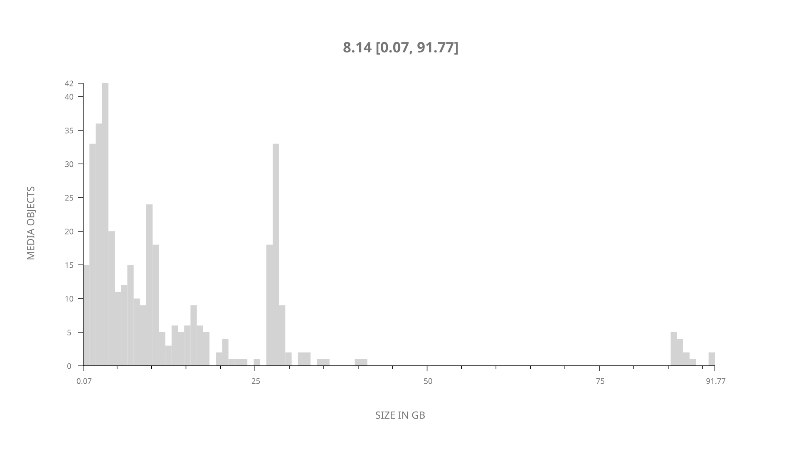
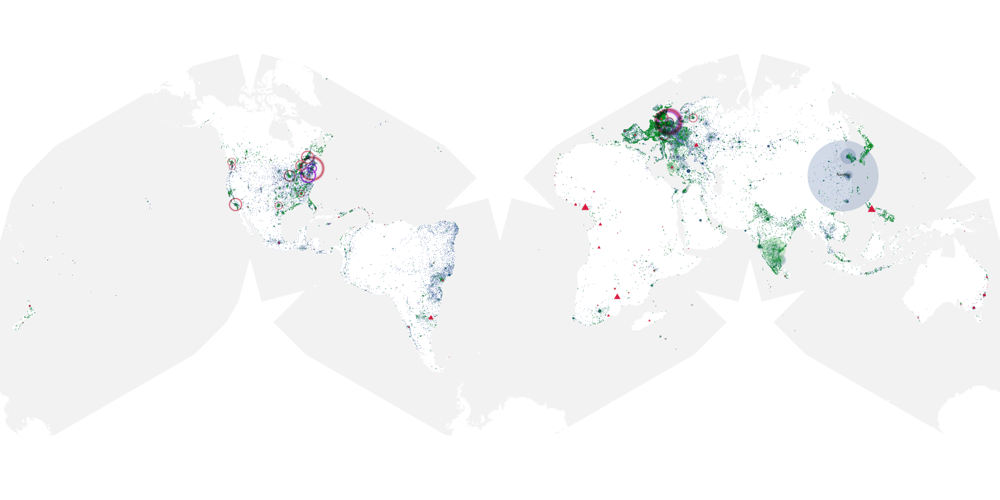
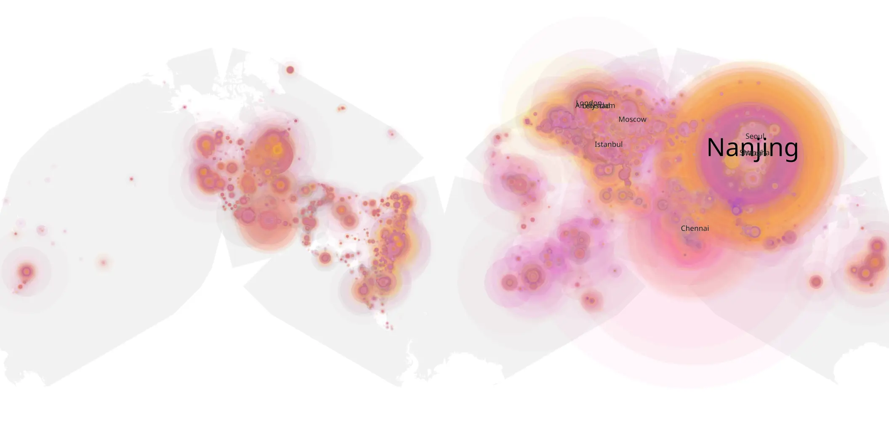
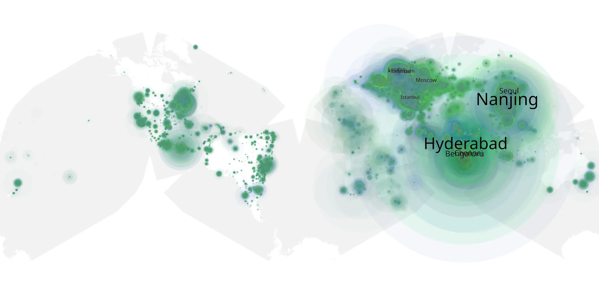

# spider-man-brand-new-day sample cache audit

## 1. Media object

| Field | Value |
| --- | --- |
| Media object | Spider-Man: Brand New Day |
| Collection key | `spider-man-brand-new-day` |
| imdb_id | [tt22084616](https://www.imdb.com/title/tt22084616/) |
| wikipedia_url | [Spider-Man: Brand New Day](https://en.wikipedia.org/wiki/Spider-Man:_Brand_New_Day) |
| Sample dates | 2026-10-07-to-2026-11-10 |
| Sample days | 35 |
| BTIH count | 409 |
| Unique BTIH count | 384 |
| Downloaders total | 21,644,523 |
| Uploaders total | 3,961,079 |
| Data version | `2026-08-05` |
| IP geolocation version | `6:1777968300` |

## 2. Coverage report

- Generated: 2026-11-20T16:00:07Z
- Sample archive directory: `/mnt/gold/src/alpha60-samples-raw.gold/spider-man-brand-new-day.xz`
- Hour directories: 838
- Other unparsable sample files: 0
- Hourly discontinuities: 1 (1 missing hours)
- Missing days: 0

### Sample archive discontinuities

- hourly gap: last `2026-11-08 22:04`, resumed `2026-11-09 00:04` — missing 1 hour(s)

## 3. File sizes histogram *median[lowest, highest]*

## 4. Graphs

### Downloads by week cumulative (normalized start)



### Downloads by day, Saturday and Sunday in gray

## 5. Cumulative Maps

<!-- https://raw.githubusercontent.com/alpha60-devops/alpha60-results-2026/refs/heads/main/data/ -->

### <a href="https://raw.githubusercontent.com/alpha60-devops/alpha60-results-2026/refs/heads/main/data/geojson.cumulative/spider-man-brand-new-day-cumulative-aggregate.geojson.gz" data-map-title="Spider-Man: Brand New Day — spider-man-brand-new-day" onclick="leaflet_map_open_window(this.href, this.dataset.mapTitle); return false;" class="table-link" aria-label="Open Spider-Man: Brand New Day (spider-man-brand-new-day) cumulative data map in new window" title="Opens interactive map for Spider-Man: Brand New Day (spider-man-brand-new-day) data">Swarm Detail</a>

### Geographic Regions

| Africa | Americas | Asia | Europe | Oceania | Unknown |
| --- | --- | --- | --- | --- | --- |
| 4.38 | 17.04 | 40.15 | 36.34 | 1.40 | 0.69 |

### Network infrastructure

{:target="_blank" rel="noopener"}

### Resolution >= 1080p

{:target="_blank" rel="noopener"}

### Resolution < 1080p

{:target="_blank" rel="noopener"}
