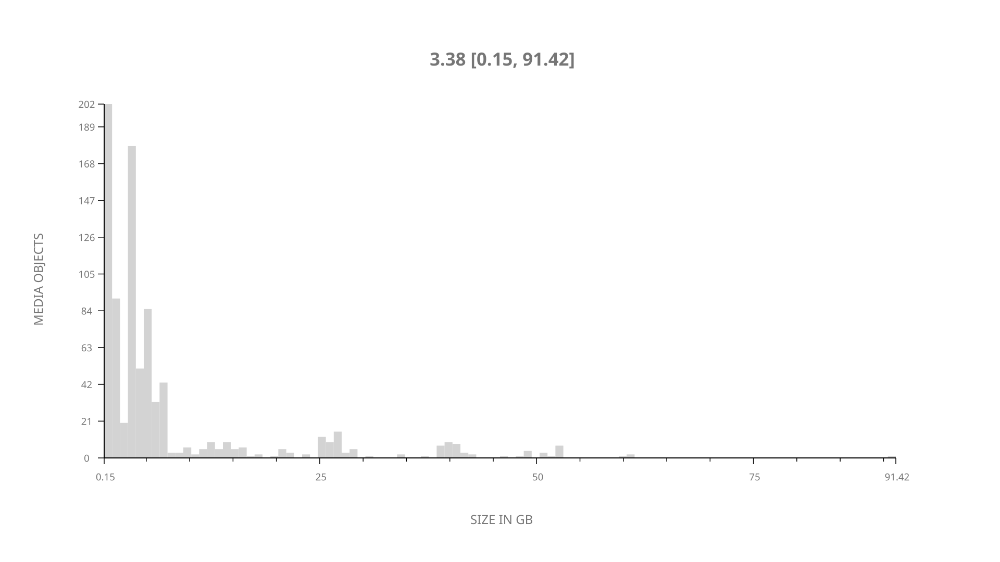
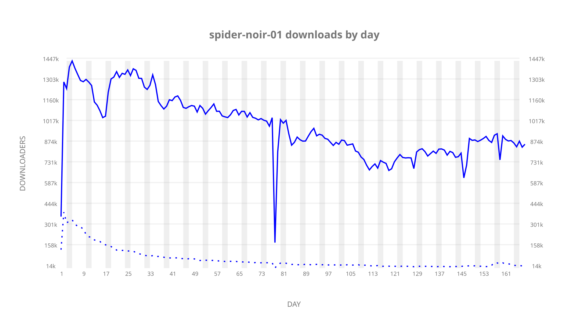
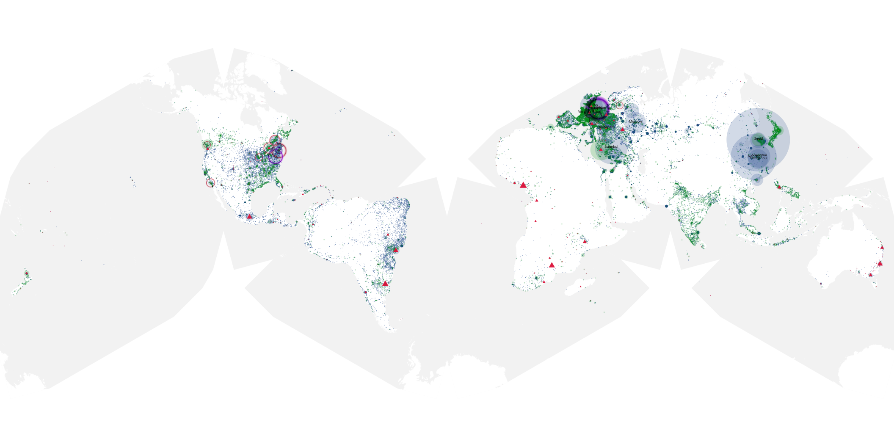
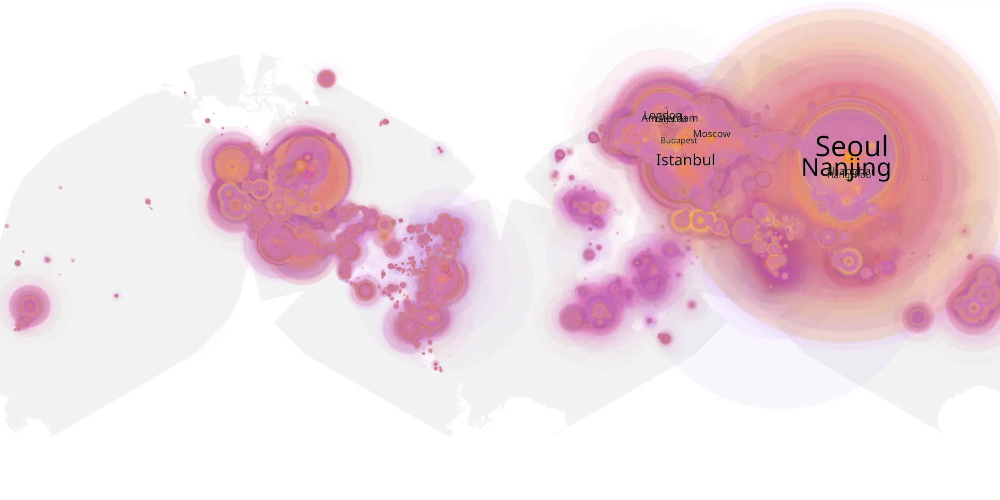
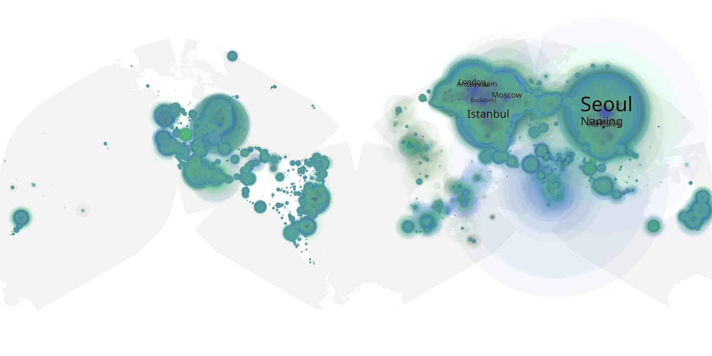

# spider-noir-01 sample cache audit

## 1. Media object

| Field | Value |
| --- | --- |
| Media object | Spider-Noir |
| Collection key | `spider-noir-01` |
| imdb_id | [tt30460310](https://www.imdb.com/title/tt30460310/) |
| wikipedia_url | [Spider-Noir](https://en.wikipedia.org/wiki/Spider-Noir) |
| Sample dates | 2026-05-27-to-2026-11-10 |
| Sample days | 168 |
| BTIH count | 878 |
| Unique BTIH count | 867 |
| Downloaders total | 121,621,895 |
| Uploaders total | 6,120,307 |
| Data version | `2026-08-05` |
| IP geolocation version | `6:1777968300` |

## 2. Coverage report

- Generated: 2026-11-20T00:54:48Z
- Sample archive directory: `/mnt/gold/src/alpha60-samples-raw.gold/spider-noir-01.xz`
- Hour directories: 3978
- Other unparsable sample files: 0
- Hourly discontinuities: 4 (37 missing hours)
- Missing days: 0

### Sample archive discontinuities

- hourly gap: last `2026-08-12 03:04`, resumed `2026-08-13 06:04` — missing 26 hour(s)
- hourly gap: last `2026-09-30 22:04`, resumed `2026-10-01 02:04` — missing 3 hour(s)
- hourly gap: last `2026-10-01 22:04`, resumed `2026-10-02 00:35` — missing 1 hour(s)
- hourly gap: last `2026-10-31 22:04`, resumed `2026-11-01 06:17` — missing 7 hour(s)

## 3. File sizes histogram *median[lowest, highest]*

## 4. Graphs

### Downloads by week cumulative (normalized start)



### Downloads by day, Saturday and Sunday in gray

## 5. Cumulative Maps

<!-- https://raw.githubusercontent.com/alpha60-devops/alpha60-results-2026/refs/heads/main/data/ -->

### <a href="https://raw.githubusercontent.com/alpha60-devops/alpha60-results-2026/refs/heads/main/data/geojson.cumulative/spider-noir-01-cumulative-aggregate.geojson.gz" data-map-title="Spider-Noir — spider-noir-01" onclick="leaflet_map_open_window(this.href, this.dataset.mapTitle); return false;" class="table-link" aria-label="Open Spider-Noir (spider-noir-01) cumulative data map in new window" title="Opens interactive map for Spider-Noir (spider-noir-01) data">Swarm Detail</a>

### Geographic Regions

| Africa | Americas | Asia | Europe | Oceania | Unknown |
| --- | --- | --- | --- | --- | --- |
| 1.91 | 18.20 | 35.19 | 42.64 | 1.20 | 0.86 |

### Network infrastructure

{:target="_blank" rel="noopener"}

### Resolution >= 1080p

{:target="_blank" rel="noopener"}

### Resolution < 1080p

{:target="_blank" rel="noopener"}

## Data downloads

Full per-torrent GeoJSON is awaiting AAO verification.
