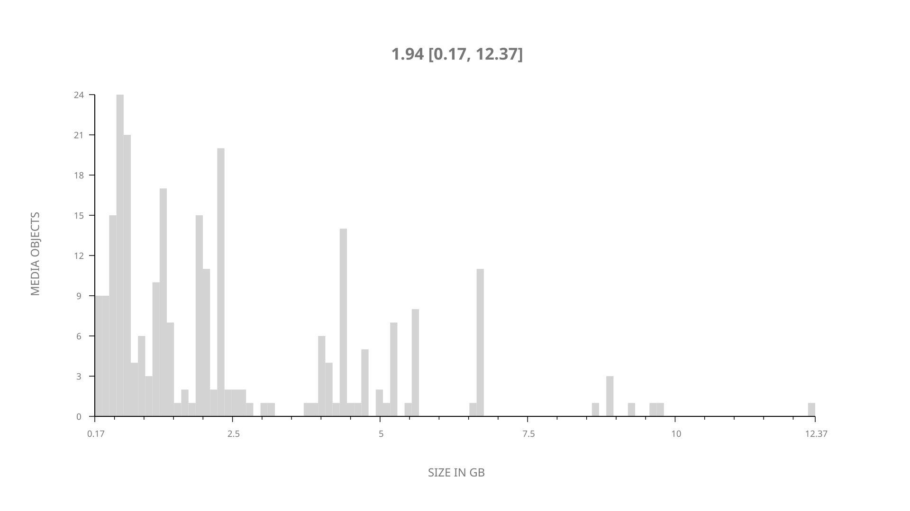
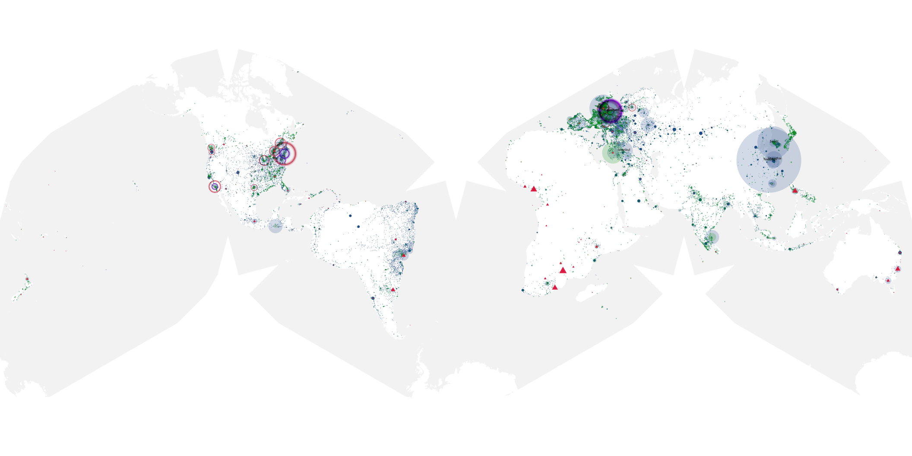
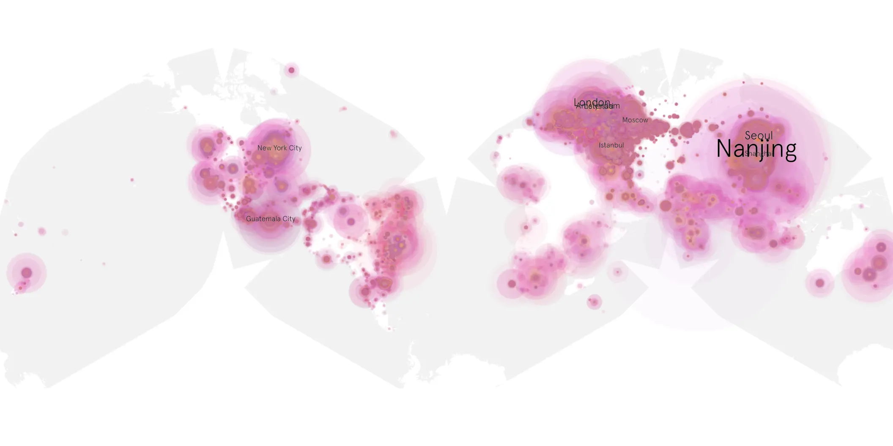
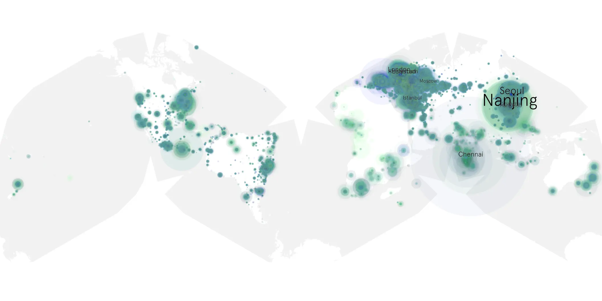

# visionquest-101 sample cache audit

## 1. Media object

| Field | Value |
| --- | --- |
| Media object | VisionQuest |
| Collection key | `visionquest-101` |
| imdb_id | [tt23112594](https://www.imdb.com/title/tt23112594/) |
| wikipedia_url | [VisionQuest](https://en.wikipedia.org/wiki/VisionQuest) |
| Sample dates | 2026-10-14-to-2026-11-10 |
| Sample days | 28 |
| BTIH count | 264 |
| Unique BTIH count | 259 |
| Downloaders total | 7,148,620 |
| Uploaders total | 983,533 |
| Data version | `2026-08-05` |
| IP geolocation version | `6:1777968300` |

## 2. Coverage report

- Generated: 2026-11-17T06:40:20Z
- Sample archive directory: `/mnt/gold/src/alpha60-samples-raw.gold/visionquest-101.xz`
- Hour directories: 654
- Other unparsable sample files: 0
- Hourly discontinuities: 0 (0 missing hours)
- Missing days: 0

### Sample archive discontinuities

None detected.

## 3. File sizes histogram *median[lowest, highest]*

## 4. Graphs

### Downloads by week cumulative (normalized start)



### Downloads by day, Saturday and Sunday in gray

## 5. Cumulative Maps

<!-- https://raw.githubusercontent.com/alpha60-devops/alpha60-results-2026/refs/heads/main/data/ -->

### <a href="https://raw.githubusercontent.com/alpha60-devops/alpha60-results-2026/refs/heads/main/data/geojson.cumulative/visionquest-101-cumulative-aggregate.geojson.gz" data-map-title="VisionQuest — visionquest-101" onclick="leaflet_map_open_window(this.href, this.dataset.mapTitle); return false;" class="table-link" aria-label="Open VisionQuest (visionquest-101) cumulative data map in new window" title="Opens interactive map for VisionQuest (visionquest-101) data">Swarm Detail</a>

### Geographic Regions

| Africa | Americas | Asia | Europe | Oceania | Unknown |
| --- | --- | --- | --- | --- | --- |
| 3.74 | 22.89 | 32.00 | 38.74 | 1.92 | 0.71 |

### Network infrastructure

{:target="_blank" rel="noopener"}

### Resolution >= 1080p

{:target="_blank" rel="noopener"}

### Resolution < 1080p

{:target="_blank" rel="noopener"}
