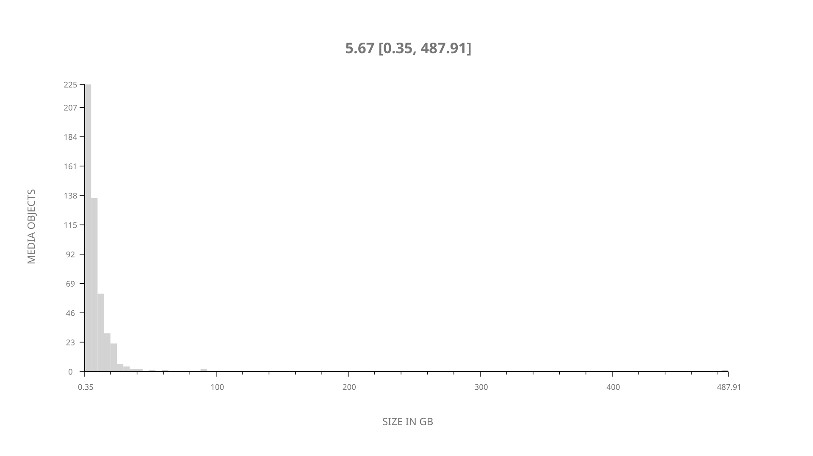
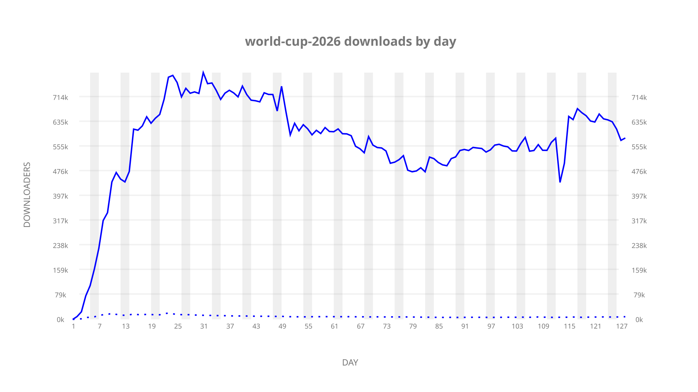
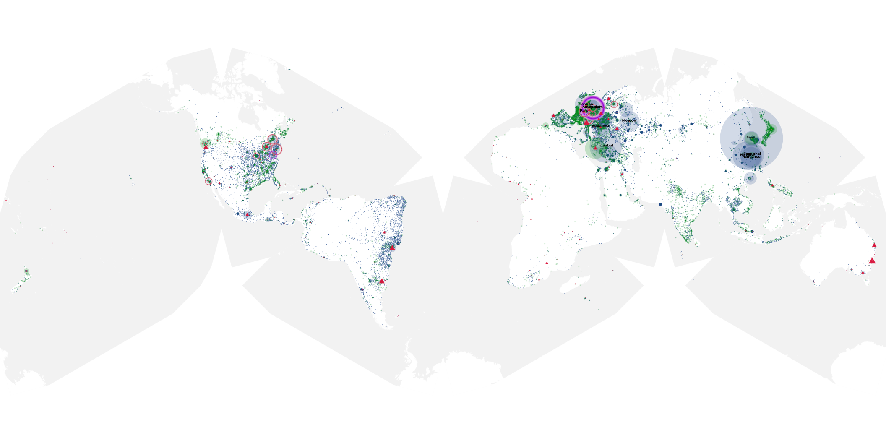
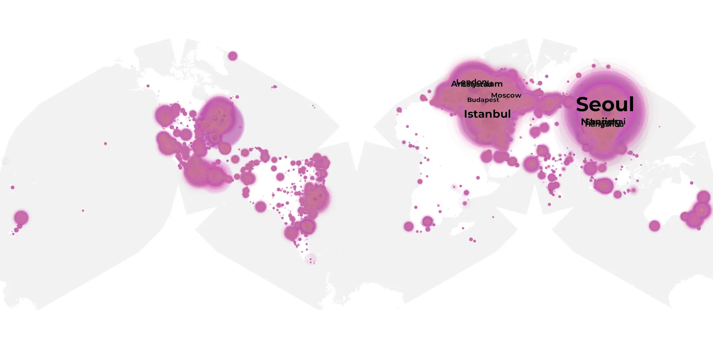
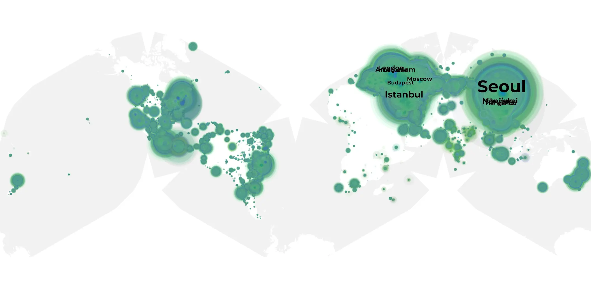

# world-cup-2026 sample cache audit

## 1. Media object

| Field | Value |
| --- | --- |
| Media object | 2026 FIFA World Cup |
| Collection key | `world-cup-2026` |
| imdb_id | [tt32915471](https://www.imdb.com/title/tt32915471/) |
| wikipedia_url | [2026 FIFA World Cup](https://en.wikipedia.org/wiki/2026_FIFA_World_Cup) |
| Sample dates | 2026-06-29-to-2026-11-03 |
| Sample days | 128 |
| BTIH count | 574 |
| Unique BTIH count | 493 |
| Downloaders total | 58,183,368 |
| Uploaders total | 583,270 |
| Data version | `2026-08-05` |
| IP geolocation version | `6:1777968300` |

## 2. Coverage report

- Generated: 2026-11-06T05:44:53Z
- Sample archive directory: `/mnt/gold/src/alpha60-samples-raw.gold/world-cup-2026.xz`
- Hour directories: 3068
- Zero-length sample files: 0
- Other unparsable sample files: 0
- Hourly discontinuities: 0 (0 missing hours)
- Missing days: 0

### Sample archive discontinuities

None detected.

### Validation scope

- Validated sample window: 2026-06-29 through 2026-11-03.
- Raw JSON members parsed: 22408379.
- This scan checks raw JSON syntax and the archive timeline; collection filtering and cache production are separate steps.
- Raw validation receipt SHA-256: `b53830dd80268b763f5afffc543f6985f8c4de729f69ef293c7a289231ce9b11`.
- Raw source archives and supplied cache archives were read without modification.

### Cache snapshot evidence

- `cache.20261103.tar.xz` SHA-256: `03f2e700a7d4103329c04c70d10c7d2fcc8d5225cd12b989e43bba6c4296cb61`.
- `tmp.tar.xz` SHA-256: `1898b81fea8a36707063495227fdc0cae24512874fe84b237ae0e58ace17fadb`.
- Validated daily JSON/GeoJSON pairs: 128.
- Cumulative downloader and uploader totals reconcile with the supplied per-torrent cumulative cache records.
- [Raw-source validation](https://github.com/alpha60-devops/alpha60-results-2026/blob/main/data/txt/results-pages-20261105/world-cup-2026/raw-validation.json) and [cache validation](https://github.com/alpha60-devops/alpha60-results-2026/blob/main/data/txt/results-pages-20261105/world-cup-2026/cache-validation.json).

## 3. File sizes histogram *median[lowest, highest]*

## 4. Graphs

### Downloads by week cumulative (normalized start)



<!-- BEGIN world-cup-torrent-country-graphs -->

### Graph by Event



### Graph by Top Country Downloaders



<!-- END world-cup-torrent-country-graphs -->

### Downloads by day, Saturday and Sunday in gray

## 5. Cumulative Maps

<!-- https://raw.githubusercontent.com/alpha60-devops/alpha60-results-2026/refs/heads/main/data/ -->

### <a href="https://raw.githubusercontent.com/alpha60-devops/alpha60-results-2026/refs/heads/main/data/geojson.cumulative/world-cup-2026-cumulative-aggregate.geojson.gz" data-map-title="2026 FIFA World Cup — world-cup-2026" onclick="leaflet_map_open_window(this.href, this.dataset.mapTitle); return false;" class="table-link" aria-label="Open 2026 FIFA World Cup (world-cup-2026) cumulative data map in new window" title="Opens interactive map for 2026 FIFA World Cup (world-cup-2026) data">Swarm Detail</a>

### Geographic Regions

| Africa | Americas | Asia | Europe | Oceania | Unknown |
| --- | --- | --- | --- | --- | --- |
| 1.36 | 18.43 | 33.66 | 44.58 | 1.06 | 0.91 |

### Network infrastructure

{:target="_blank" rel="noopener"}

### Resolution >= 1080p

{:target="_blank" rel="noopener"}

### Resolution < 1080p

{:target="_blank" rel="noopener"}
